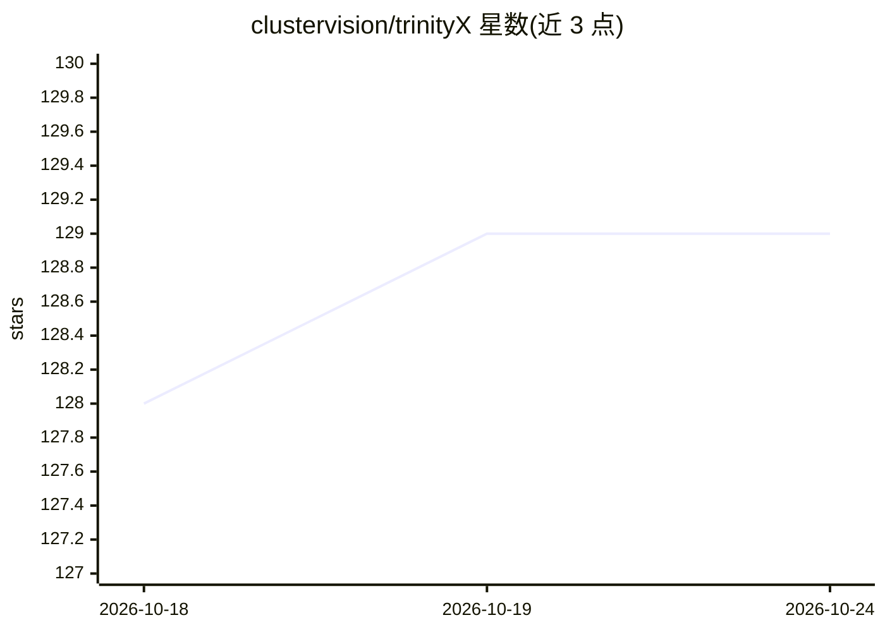

# clustervision/trinityX

⭐ 129 · Jinja · GPL-3.0 · 推送 2026-10-23 · [GitHub](https://github.com/clustervision/trinityX) · 组织维护

**企业级 HPC/AI 集群部署管理平台，供集群管理员快速搭建集群**

ClusterVision 开源的 HPC、AI 与云集群部署平台，基于 Ansible playbook 安装：在 Enterprise Linux 8/9/10 控制节点上部署 Luna 节点供应器、OpenLDAP/389DS、SLURM 或 OpenPBS、Prometheus/Grafana、Open OnDemand、NFS 共享目录、HA 高可用等集群服务，并生成 RedHat/Rocky 或 Ubuntu 计算节点 OS 镜像。支持图形化安装器、INSTALL.sh 引导与手动三种安装方式，支持 HA、Air-Gapped 离线安装、EasyBuild 与自带的跨发行版 Slurm 构建；OpenHPC 集成在 16 版标记为废弃（仅供迁移）。

## 筛选速览

| 维度 | 判定 | 备注 |
|---|---|---|
| AI 角色 | `ai-ecosystem` | LLM/agent 周边工具 |
| 许可风险 | `viral` | GPL-3.0 |
| 部署形态 | `None` |  |
| 模型依赖 | — | README 未给出锁定关系 |
| 硬件要求 | — | 无带数字的原话,不猜 |
| 安装摩擦 | `low` | 无编译、无系统依赖或容器化 |
| 成熟度 | — | 结构信号不足 |

## 能力要点

- Ansible playbook 一键部署控制节点与计算节点 OS 镜像
- 内置 Luna 节点供应器、SLURM/OpenPBS 调度器、Open OnDemand 等服务
- 支持 HA 高可用与 Air-Gapped 离线安装
- EasyBuild 集成可通过 enable_easybuild 开关启用

## 适用场景

- 搭建和管理 HPC/AI 计算集群的全部基础服务
- 在双控制器上部署高可用集群控制层
- 离线（无互联网）环境内部署集群

## 场景标签

`MLOps` · 领域:训练与推理

## 证据(README 行号)

> L9: TrinityX is the new generation of ClusterVision's open-source HPC, AI and cloud platform. It is designed from the gr
> L13: In standard configuration TrinityX provides the following services to the cluster:

## 星数曲线

2026-10-18 128 → 2026-10-24 129（+1）

---
*卡片 v1 · prompt 1.4 · 生成 2026-10-22 · 置信度 high · 依据 README sha `362571f59b05` · [字段定义](../../DATASET.md)*
