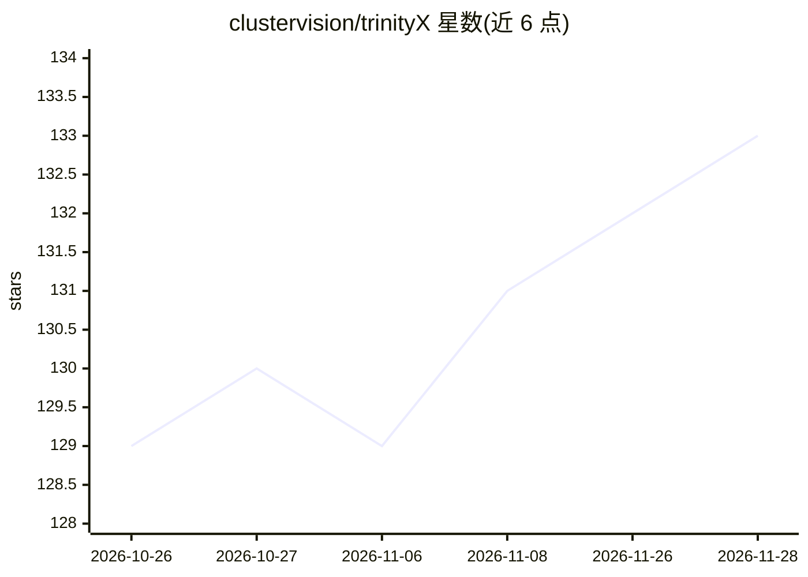

# clustervision/trinityX

⭐ 133 · Jinja · GPL-3.0 · 推送 2026-11-27 · [GitHub](https://github.com/clustervision/trinityX) · 组织维护

**面向 HPC/AI 集群的开源部署管理平台**

ClusterVision 开源的集群部署平台 TrinityX 16，通过 Ansible playbook 在 Enterprise Linux 控制器上安装并提供节点供给（Luna）、LDAP、SLURM/OpenPBS 调度、Prometheus/Grafana 监控、Open OnDemand、NFS 共享目录与 HA 等服务。提供图形安装器、git clone 加脚本、手动三种安装方式，组件可通过 controller.yml 增删；OpenHPC 集成已标记为弃用，仅用于迁移。

## 筛选速览

| 维度 | 判定 | 备注 |
|---|---|---|
| AI 角色 | `ai-ecosystem` | LLM/agent 周边工具 |
| 许可风险 | `viral` | GPL-3.0 |
| 部署形态 | `None` |  |
| 模型依赖 | — | README 未给出锁定关系 |
| 硬件要求 | — | 无带数字的原话,不猜 |
| 安装摩擦 | `low` | 无编译、无系统依赖或容器化 |
| 成熟度 | — | 结构信号不足 |

## 能力要点

- Ansible 驱动的控制器与计算节点安装流程，含 HA 与 Air-Gapped 安装选项
- 默认捆绑 Luna 节点供给器与优化版 Slurm 构建（跨发行版/架构）
- 组件可裁剪：controller.yml 与 group_vars 支持自定义
- EasyBuild 集成提供科学、AI 与 HPC 应用的构建框架

## 适用场景

- 为新采购的 HPC/AI 集群部署控制器、调度器与监控服务
- 管理需要高可用控制节点的集群
- 为科研团队提供 Open OnDemand 图形化管理入口

## 场景标签

 · 领域:HPC/基础设施运维

## 证据(README 行号)

> L9: TrinityX is the new generation of ClusterVision's open-source HPC, AI and cloud platform. It is designed from the gr
> L13: In standard configuration TrinityX provides the following services to the cluster:
> L111:  # ansible-playbook controller.yml

## 星数曲线

2026-10-26 129 → 2026-11-28 133（+4）

---
*卡片 v1 · prompt 1.4 · 生成 2026-11-28 · 置信度 high · 依据 README sha `bed506701e31` · [字段定义](../../DATASET.md)*
