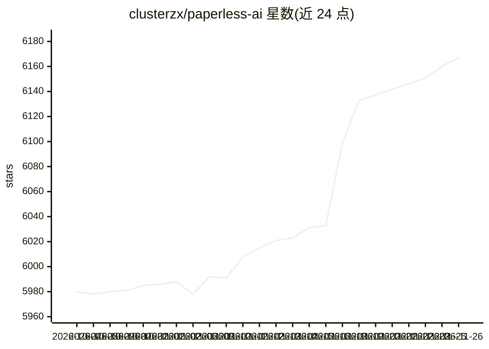

# clusterzx/paperless-ai

⭐ 6,167 · TypeScript · MIT · 推送 2026-11-25 · [GitHub](https://github.com/clusterzx/paperless-ai) · [官网](https://clusterzx.github.io/paperless-ai/) · 个人维护

**为 Paperless-ngx 或独立文档库自动打标签并支持归档问答**

对文档自动填写标题、标签、往来方、文档类型、日期与自定义字段，并支持用自然语言对整个文档库提问、回答附引用来源。可作为 Paperless-ngx（2.x/3.x）扩展运行，也可用内置文档库独立运行。支持本地 PaddleOCR（CPU 或 NVIDIA GPU）读取质量差的扫描件，提供 MCP 服务器供外部 agent 调用。部署方式为 docker compose，安装后通过设置向导配置账号、文档库、AI 提供商与处理选项；文档提醒不要将实例无防护地暴露到公网。

## 筛选速览

| 维度 | 判定 | 备注 |
|---|---|---|
| AI 角色 | `ai-native` | 本体是模型或模型工具 |
| 许可风险 | `permissive` | MIT |
| 部署形态 | `self-host` | docker 或自建部署 |
| 模型依赖 | local-ok | 支持本地模型 |
| 硬件要求 | — | 无带数字的原话,不猜 |
| 安装摩擦 | `low` | 无编译、无系统依赖或容器化 |
| 成熟度 | — | 结构信号不足 |

## 能力要点

- 自动为文档生成标题、标签、往来方、类型、日期与自定义字段
- 自然语言归档问答，混合关键词与向量检索，回答附引用来源
- PaddleOCR 本地 OCR（CPU 或 NVIDIA GPU）读取扫描件与照片
- 提供 MCP 服务器，供 Claude/Hermes/OpenCode 等 agent 搜索与操作文档

## 适用场景

- 自动整理 Paperless-ngx 中新进文档的元数据
- 对家庭或团队文档库用自然语言提问并查看出处
- 无 Paperless-ngx 时用内置库从邮件/WebDAV/文件夹收集文档
- 为外部 AI agent 提供带权限控制的文档库访问接口

## 场景标签

`OCR` `文档解析` `文档问答` · 领域:知识与检索

## 证据(README 行号)

> L8: **Paperless-AI** analyzes your documents and fills in title, tags, correspondent, document type, date and custom fie
> L10: AI providers: OpenAI, Anthropic (Claude), **Ollama (fully local)**, Azure OpenAI and every OpenAI-compatible API (D

## 星数曲线

2026-10-24 5,980 → 2026-11-26 6,167（+187）

---
*卡片 v1 · prompt 1.4 · 生成 2026-11-26 · 置信度 high · 依据 README sha `7c0a7db6940b` · [字段定义](../../DATASET.md)*
