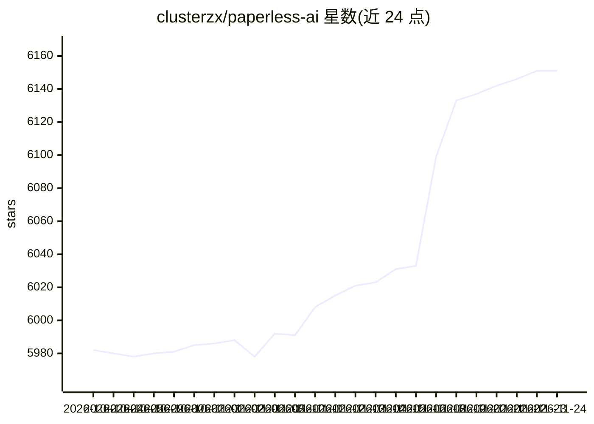

# clusterzx/paperless-ai

⭐ 6,151 · TypeScript · MIT · 推送 2026-11-22 · [GitHub](https://github.com/clusterzx/paperless-ai) · [官网](https://clusterzx.github.io/paperless-ai/) · 个人维护

**为 Paperless-ngx 文档库自动打标并支持自然语言问答**

分析文档并自动填写标题、标签、往来方、文档类型、日期与自定义字段，支持对整个文档库用自然语言提问并给出带出处的回答。可作为 Paperless-ngx 2.x/3.x 的扩展运行，也可脱离它使用内置档案库（上传、文件夹监听、邮件、WebDAV、回收站、多库权限）。内置 PaddleOCR 在本地读取扫描件（CPU 或 NVIDIA GPU），并提供 MCP server 供 Claude 等 agent 检索和操作文档。通过 docker compose 部署，首次访问有设置向导。

## 筛选速览

| 维度 | 判定 | 备注 |
|---|---|---|
| AI 角色 | `ai-enhanced` | 去掉 AI 部分产品仍成立 |
| 许可风险 | `permissive` | MIT |
| 部署形态 | `self-host` | docker 或自建部署 |
| 模型依赖 | local-ok | 支持本地模型 |
| 硬件要求 | — | 无带数字的原话,不猜 |
| 安装摩擦 | `low` | 无编译、无系统依赖或容器化 |
| 成熟度 | — | 结构信号不足 |

## 能力要点

- 自动补全文档元数据：标题、标签、往来方、类型、日期、自定义字段
- 自然语言问答覆盖全档案库，回答附引用来源，混合关键词与向量检索
- 本地 PaddleOCR（CPU/NVIDIA GPU）读取扫描与照片
- 提供 MCP server，支持 Claude/Hermes/OpenCode 等 agent 细粒度权限操作文档

## 适用场景

- 让新扫描文档自动打标归档，免去手工整理
- 用提问方式在个人文档库中查找合同、账单内容
- 无 Paperless-ngx 环境下用内置档案库管理文档
- 让 Claude 等 agent 通过 MCP 检索和修改文档库

## 场景标签

`文档解析` `文档问答` `OCR` · 领域:知识与检索

## 证据(README 行号)

> L8: **Paperless-AI** analyzes your documents and fills in title, tags, correspondent, document type, date and custom fie
> L21: - **Built-in archive** – run without Paperless-ngx: upload, watch folders, e-mail, WebDAV, phone, versions, trash, 

## 星数曲线

2026-10-22 5,982 → 2026-11-24 6,151（+169）

---
*卡片 v1 · prompt 1.4 · 生成 2026-11-23 · 置信度 mid · 依据 README sha `42747ff3fda6` · [字段定义](../../DATASET.md)*
