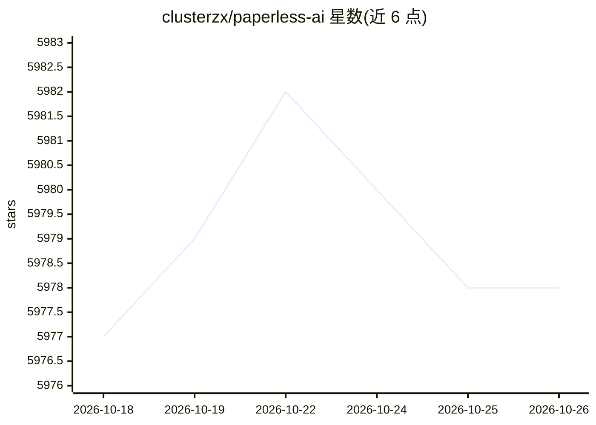

# clusterzx/paperless-ai

⭐ 5,978 · JavaScript · MIT · 推送 2026-10-16 · [GitHub](https://github.com/clusterzx/paperless-ai) · [官网](https://clusterzx.github.io/paperless-ai/) · 个人维护

**为 Paperless-ngx 自动分类打标签并提供 RAG 问答的扩展**

Paperless-ngx 的 Web 应用扩展：自动检测新文档，调用 OpenAI 兼容 API 或 Ollama 等后端分析内容，指派标题、标签、文档类型与往来单位；支持基于 RAG 的自然语言文档问答与语义检索，规则可限制处理范围，并提供 /manual 手动打标界面。以 Docker 部署为主（首次配置后需重启以构建 RAG 索引），本地开发走 npm。注意：README 声明仓库当前不再维护，作者在重写代码库，且随 Paperless-ngx 官方 AI 集成推出，后续维护不确定。

## 筛选速览

| 维度 | 判定 | 备注 |
|---|---|---|
| AI 角色 | `ai-native` | 本体是模型或模型工具 |
| 许可风险 | `permissive` | MIT |
| 部署形态 | `self-host` | docker 或自建部署 |
| 模型依赖 | local-ok | 支持本地模型 |
| 硬件要求 | — | 无带数字的原话,不猜 |
| 安装摩擦 | `low` | 无编译、无系统依赖或容器化 |
| 成熟度 | — | 结构信号不足 |

## 能力要点

- 自动检测新文档并指派标题/标签/类型/往来单位
- 内置 Ollama（Mistral、Llama、Phi-3、Gemma-2）、OpenAI、DeepSeek、Gemini 等多种后端
- 基于 RAG 的自然语言文档问答与语义检索
- Docker 部署含健康监控、持久卷与优雅停机

## 适用场景

- 让 Paperless-ngx 里的新文档自动分类打标签
- 用自己的文档库做语义问答（如查电费金额、租约日期）
- 对敏感文档通过手动界面逐份审核打标

## 场景标签

`文档问答` `语义搜索` `工作流自动化` · 领域:效率与自动化

## 证据(README 行号)

> L13: **Paperless-AI** is an AI-powered extension for Paperless-ngx that brings automatic document classification, smart 
> L22: Powered by **Retrieval-Augmented Generation (RAG)**, you can now search semantically across your full archive and g

## 星数曲线

2026-10-18 5,977 → 2026-10-26 5,978（+1）

---
*卡片 v1 · prompt 1.4 · 生成 2026-10-20 · 置信度 high · 依据 README sha `ca5d9c20aab6` · [字段定义](../../DATASET.md)*
