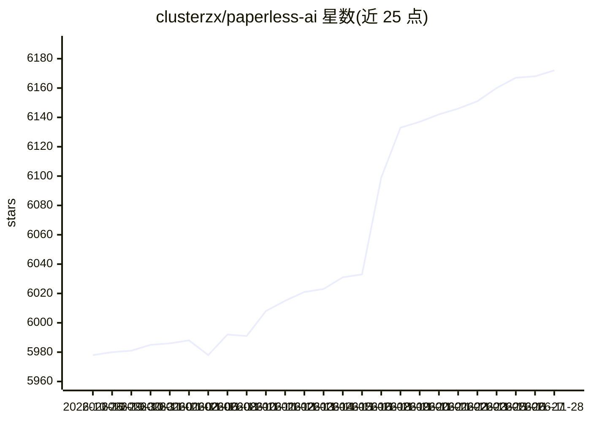

# clusterzx/paperless-ai

⭐ 6,172 · TypeScript · MIT · 推送 2026-11-27 · [GitHub](https://github.com/clusterzx/paperless-ai) · [官网](https://clusterzx.github.io/paperless-ai/) · 个人维护

**为 Paperless-ngx 文档库自动生成元数据并支持问答的工具**

自动分析文档并填写标题、标签、通信方、文档类型、日期与自定义字段，支持自然语言向整个档案提问并给出带出处的回答。可作为 Paperless-ngx 2.x/3.x 的扩展，也可用内置档案独立运行（支持上传、文件夹监视、邮件、WebDAV 等取件途径）。通过 PaddleOCR 在本地识别扫描件与照片，并可生成可搜索 PDF；提供 MCP 服务器供 agent 检索与修改文档。以 Docker 方式部署，端口 3000，含设置向导、双因素认证与单点登录。

## 筛选速览

| 维度 | 判定 | 备注 |
|---|---|---|
| AI 角色 | `ai-native` | 本体是模型或模型工具 |
| 许可风险 | `permissive` | MIT |
| 部署形态 | `self-host` | docker 或自建部署 |
| 模型依赖 | local-ok | 支持本地模型 |
| 硬件要求 | — | 无带数字的原话,不猜 |
| 安装摩擦 | `low` | 无编译、无系统依赖或容器化 |
| 成熟度 | — | 结构信号不足 |

## 能力要点

- 自动填写文档元数据，支持定时或 Paperless-ngx 工作流触发
- 本地 PaddleOCR（CPU 或 NVIDIA GPU）读取扫描件并生成可搜索 PDF
- 自然语言档案问答，混合关键词与向量检索并引用来源
- 内置 MCP 服务器，供 Claude 等 agent 搜索/读取/修改文档

## 适用场景

- 自动为 Paperless-ngx 新文档补全标题、标签与类型
- 用自然语言查询租房合同、账单等档案内容
- 扫描件批量本地 OCR 并生成可搜索 PDF
- 让外部 agent 通过 MCP 管理和检索文档库

## 场景标签

`OCR` `文档解析` · 领域:知识与检索

## 证据(README 行号)

> L8: **Paperless-AI** analyzes your documents and fills in title, tags, correspondent, document type, date and custom fie
> L10: AI providers: OpenAI, Anthropic (Claude), **Ollama (fully local)**, Azure OpenAI and every OpenAI-compatible API (D
> L19: - **Ask your archive** – questions in plain language, hybrid keyword and vector search, answers with sources

## 星数曲线

2026-10-26 5,978 → 2026-11-28 6,172（+194）

---
*卡片 v1 · prompt 1.4 · 生成 2026-11-27 · 置信度 high · 依据 README sha `90199d5296a1` · [字段定义](../../DATASET.md)*
