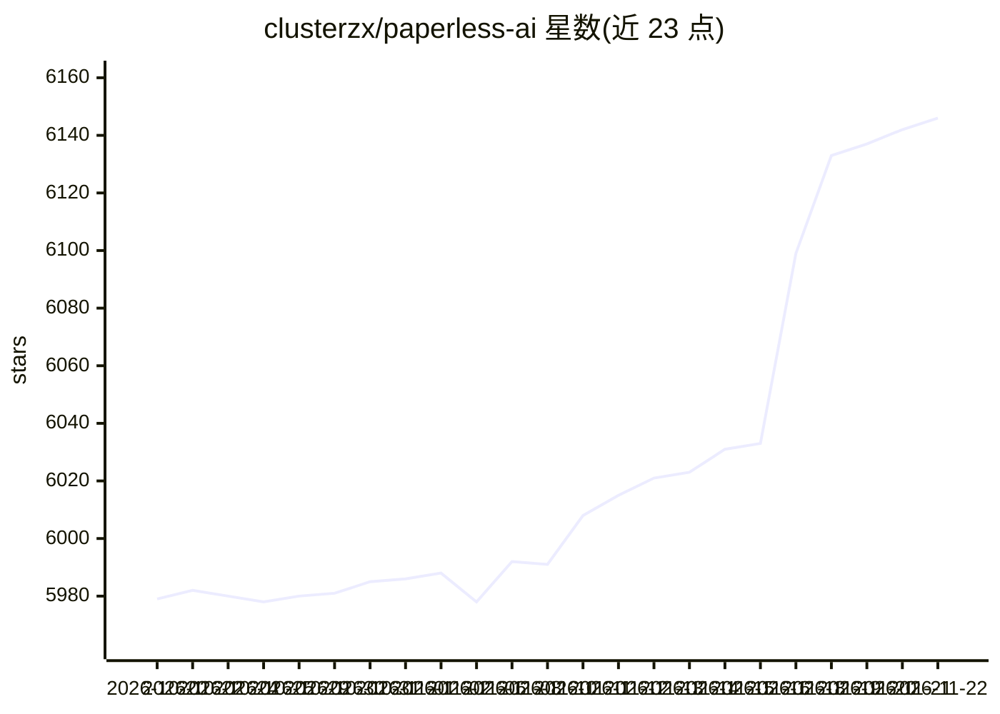

# clusterzx/paperless-ai

⭐ 6,146 · TypeScript · MIT · 推送 2026-11-21 · [GitHub](https://github.com/clusterzx/paperless-ai) · [官网](https://clusterzx.github.io/paperless-ai/) · 个人维护

**为 Paperless-ngx 自动打标签归档文档并支持全库问答的 AI 扩展**

作为 Paperless-ngx 的 AI 扩展运行：自动为新文档填写标题、标签、通讯人、文档类型、日期与自定义字段，支持定时或 webhook 触发、触发/排除标签与按文档类型的 prompt 规则；内置本地 PaddleOCR 读取低质量扫描件；提供自然语言全库问答（混合关键词与向量检索、答案带引用来源）与日历事项提取。Docker 部署，Web 界面配置，支持 2FA 与 OIDC 单点登录；需自备 Paperless-ngx 实例与 AI 提供商凭据。

## 筛选速览

| 维度 | 判定 | 备注 |
|---|---|---|
| AI 角色 | `ai-native` | 本体是模型或模型工具 |
| 许可风险 | `permissive` | MIT |
| 部署形态 | `self-host` | docker 或自建部署 |
| 模型依赖 | local-ok | 支持本地模型 |
| 硬件要求 | — | 无带数字的原话,不猜 |
| 安装摩擦 | `low` | 无编译、无系统依赖或容器化 |
| 成熟度 | — | 结构信号不足 |

## 能力要点

- 自动填写文档标题、标签、通讯人、类型、日期与自定义字段
- 本地 PaddleOCR（CPU/NVIDIA GPU）读取低质量扫描件并支持回滚
- 全库自然语言问答：混合检索、流式回答、引用来源、无 AI 成本的搜索模式
- 支持 OpenID Connect 单点登录、两步认证与 webhook API key

## 适用场景

- 让个人/家庭文档库自动完成标题与标签归类
- 用自然语言检索历史账单、合同与保险文件
- 对低质量扫描件先做本地 OCR 再交给 AI 分析

## 场景标签

`OCR` `文档解析` `文档问答` · 领域:知识与检索

## 证据(README 行号)

> L8: **Paperless-AI** is an AI extension for Paperless-ngx. It analyzes your documents and fills in title, tags, correspo
> L10: Works with **Paperless-ngx 2.x and 3.x**, OpenAI, Anthropic (Claude), **Ollama (fully local)**, Azure OpenAI and ev
> L30: **Ask your archive** – questions in plain language over all documents: hybrid keyword and vector search, streamed a

## 星数曲线

2026-10-20 5,979 → 2026-11-22 6,146（+167）

---
*卡片 v1 · prompt 1.4 · 生成 2026-11-22 · 置信度 mid · 依据 README sha `564c6a0e629f` · [字段定义](../../DATASET.md)*
