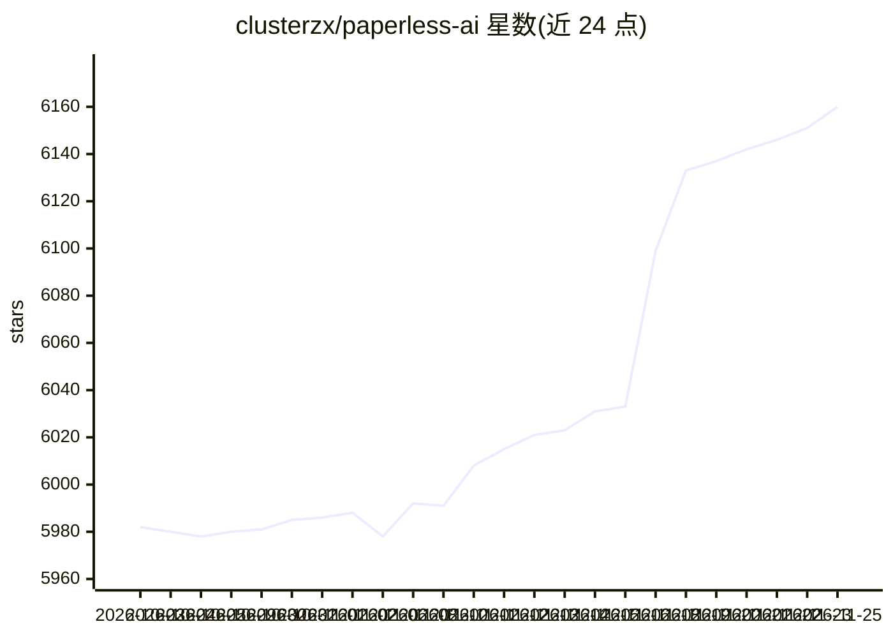

# clusterzx/paperless-ai

⭐ 6,160 · TypeScript · MIT · 推送 2026-11-23 · [GitHub](https://github.com/clusterzx/paperless-ai) · [官网](https://clusterzx.github.io/paperless-ai/) · 个人维护

**为 Paperless-ngx 文档自动打标归档并支持全库问答的 AI 工具**

分析文档并自动填写标题、标签、往来方、文档类型、日期与自定义字段，支持自然语言对整个档案库提问并给出带来源引用的回答。可作为 Paperless-ngx 2.x/3.x 的扩展，也可用内置档案库独立运行（上传、文件夹监视、邮件、WebDAV 等）。OCR 使用 PaddleOCR 在本地读取扫描件（CPU 或 NVIDIA GPU），提供 MCP 服务器供 Claude 等 agent 检索与修改文档。通过 Docker 部署，设置向导配置 AI 提供商；README 提示需置于内网或反向代理之后。

## 筛选速览

| 维度 | 判定 | 备注 |
|---|---|---|
| AI 角色 | `ai-native` | 本体是模型或模型工具 |
| 许可风险 | `permissive` | MIT |
| 部署形态 | `self-host` | docker 或自建部署 |
| 模型依赖 | local-ok | 支持本地模型 |
| 硬件要求 | — | 无带数字的原话,不猜 |
| 安装摩擦 | `low` | 无编译、无系统依赖或容器化 |
| 成熟度 | — | 结构信号不足 |

## 能力要点

- 定时或由 Paperless-ngx 工作流触发的新文档自动元数据处理
- 混合关键词与向量检索的全库问答，回答附来源引用
- PaddleOCR 本地 OCR（CPU 或 NVIDIA GPU）读取扫描件与照片
- MCP 服务器支持 Claude、Hermes、OpenCode 等 agent 操作文档

## 适用场景

- 自动为扫描文档补全标题、标签与分类元数据
- 用自然语言查询家庭或企业档案（合同、账单等）
- 完全本地化运行：Ollama + 本地 OCR 处理隐私文档
- 让 MCP agent 检索与整理现有文档库

## 场景标签

`工作流自动化` `OCR` `文档问答` `文档解析` · 领域:效率与自动化

## 证据(README 行号)

> L8: **Paperless-AI** analyzes your documents and fills in title, tags, correspondent, document type, date and custom fie
> L10: AI providers: OpenAI, Anthropic (Claude), **Ollama (fully local)**, Azure OpenAI and every OpenAI-compatible API (D
> L19: - **Ask your archive** – questions in plain language, hybrid keyword and vector search, answers with sources

## 星数曲线

2026-10-23 5,982 → 2026-11-25 6,160（+178）

---
*卡片 v1 · prompt 1.4 · 生成 2026-11-25 · 置信度 high · 依据 README sha `31b8a68f5730` · [字段定义](../../DATASET.md)*
