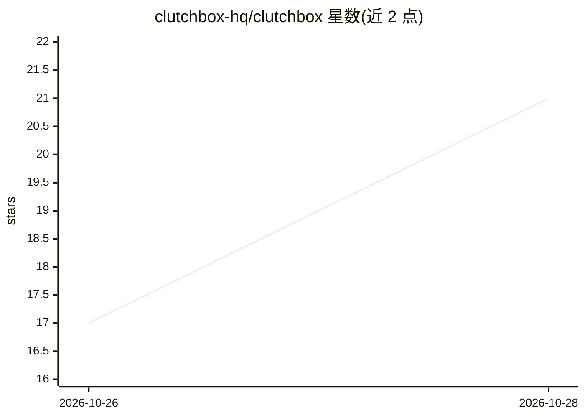

# clutchbox-hq/clutchbox

⭐ 21 · TypeScript · Apache-2.0 · 推送 2026-10-27 · [GitHub](https://github.com/clutchbox-hq/clutchbox) · [官网](https://www.clutchbox.dev) · 组织维护

**把用户登录态同步到 agent 运行环境的浏览器会话基础设施**

由 Chrome 扩展、服务端、TypeScript SDK 组成的登录态同步系统：扩展按站点逐个授权读取 cookie，服务端 AES-256-GCM 加密存储最新捕获，agent 侧通过 Playwright/CDP 适配器将差异写入 agent 浏览器，实现 agent 会话自动登录。面向两类用户：想让 Claude/ChatGPT 等 agent 以本人身份操作的个人用户，以及需让应用以各用户身份开浏览器会话的开发者。单机环境提供 Docker 自托管（需 E2B API key 与 Postgres），提供 MCP 服务端与计算机会话管理。单向同步、不动密码。

## 筛选速览

| 维度 | 判定 | 备注 |
|---|---|---|
| AI 角色 | `ai-ecosystem` | LLM/agent 周边工具 |
| 许可风险 | `permissive` | Apache-2.0 |
| 部署形态 | `self-host` | docker 或自建部署 |
| 模型依赖 | — | README 未给出锁定关系 |
| 硬件要求 | — | 无带数字的原话,不猜 |
| 安装摩擦 | `low` | 无编译、无系统依赖或容器化 |
| 成熟度 | — | 结构信号不足 |

## 能力要点

- Chrome 扩展按站点授权捕获 cookie，服务端 AES-256-GCM 加密存储
- Playwright/CDP 适配器按差异应用最新登录态到 agent 浏览器
- TypeScript SDK 可为成员开具 CDP 计算机会话（E2B 沙箱）
- Docker + Postgres 自托管整套产品，含 MCP 服务端与实时观看/接管

## 适用场景

- 让 AI agent 在已登录状态下操作我授权的网站
- 为自己的应用按用户身份开启带登录态的浏览器会话
- 替代手工导出/维护 cookie 文件，保持登录态持续更新

## 场景标签

`浏览器自动化` · 领域:效率与自动化

## 证据(README 行号)

> L21: A Chrome extension keeps the sign-ins for the sites you pick in sync, one way, to where your agents run: a hosted c
> L34: 2. Open a session for them with the SDK.

## 星数曲线

2026-10-26 17 → 2026-10-28 21（+4）

---
*卡片 v1 · prompt 1.4 · 生成 2026-10-28 · 置信度 high · 依据 README sha `dac9b0449666` · [字段定义](../../DATASET.md)*
