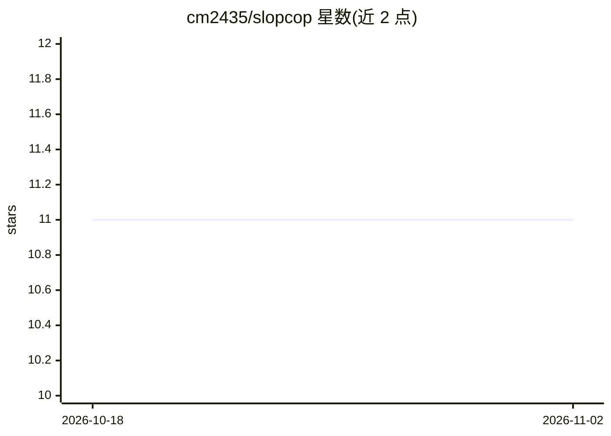

# cm2435/slopcop

⭐ 11 · Rust · MIT · 推送 2026-07-29 · [GitHub](https://github.com/cm2435/slopcop) · 个人维护

**Rust 编写的 Python linter：捕获 LLM 常见的反模式代码**

基于 tree-sitter 做 AST 分析的 Python 静态检查工具，用 Rust 编写，目标是从语言模型生成或人工编写的代码中检出常见反模式。内置 18 条规则（如禁用 hasattr/getattr、裸 except、print、Any 注解、同步函数内调用 async API 等），默认全部启用，可通过 pyproject.toml 配置排除、按文件忽略及调整规则参数，支持行内抑制注释与 GitHub Actions 集成。以 pip/uv 安装，或 cargo install 从源码构建。

## 筛选速览

| 维度 | 判定 | 备注 |
|---|---|---|
| AI 角色 | `ai-ecosystem` | LLM/agent 周边工具 |
| 许可风险 | `permissive` | MIT |
| 部署形态 | `library` | 以包/库形式分发 |
| 模型依赖 | — | README 未给出锁定关系 |
| 硬件要求 | — | 无带数字的原话,不猜 |
| 安装摩擦 | `low` | 无编译、无系统依赖或容器化 |
| 成熟度 | — | 结构信号不足 |

## 能力要点

- 18 条规则默认启用，覆盖 LLM 常见反模式（异常处理、async 误用、类型注解等）
- 基于 tree-sitter 的 AST 分析，字符串与注释中不产生误报
- pyproject.toml 项目级排除、按文件忽略、规则参数配置与行内抑制
- 退出码区分干净/违规/致命错误，可直接接入 CI

## 适用场景

- 在 CI 中检查 LLM 生成或辅助编写的 Python 代码反模式
- 统一团队代码风格（禁用 print、bare except、Any 等）
- 对测试与 CLI 目录按文件模式放宽特定规则

## 场景标签

 · 领域:开发工具/代码质量

## 证据(README 行号)

> L3: A fast, opinionated Python linter written in Rust that catches anti-patterns commonly produced by language models.
> L5: Built on tree-sitter for AST-correct analysis — no false positives on strings or comments.
> L32: CLI rule filters these semantics: `--select` replaces the default enabled set of all rules, `--ignore` removes rule

## 星数曲线

2026-10-18 11 → 2026-11-02 11（+0）

---
*卡片 v1 · prompt 1.4 · 生成 2026-11-02 · 置信度 high · 依据 README sha `0bbb7da59c69` · [字段定义](../../DATASET.md)*
