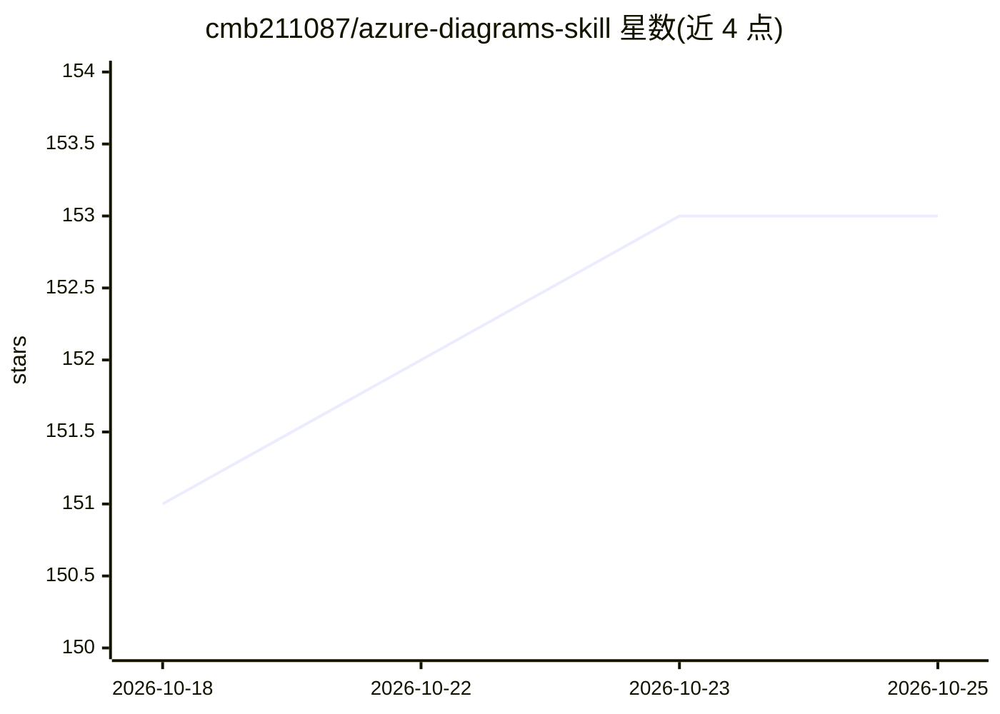

# cmb211087/azure-diagrams-skill

⭐ 153 · Python · MIT · 推送 2026-06-22 · [GitHub](https://github.com/cmb211087/azure-diagrams-skill) · [官网](https://www.linkedin.com/in/carl-brindle-88623764/) · 个人维护

**面向编码 agent 的 Azure/技术图表生成技能包**

一个基于 Agent Skills 开放标准的技能包（SKILL.md），安装到 Claude Code、GitHub Copilot、Cursor、Windsurf 等 AI 编码工具后，可用自然语言生成 Azure 架构图（800+ 官方图标、32 模块）、ERD、业务流程泳道图、时间线、UI 线框、序列图与网络拓扑，输出为代码化可版本管理的 PNG/SVG。可读取 Bicep/Terraform/ARM 等 IaC 文件生成与实际部署一致的架构图，全程本地运行不上传数据。代码执行采用沙箱隔离（导入白名单、AST 校验、子进程隔离、60 秒超时）。依赖 Graphviz 系统包与 diagrams 库（0.25.1）。

## 筛选速览

| 维度 | 判定 | 备注 |
|---|---|---|
| AI 角色 | `ai-ecosystem` | LLM/agent 周边工具 |
| 许可风险 | `permissive` | MIT |
| 部署形态 | `library` | 以包/库形式分发 |
| 模型依赖 | — | README 未给出锁定关系 |
| 硬件要求 | — | 无带数字的原话,不猜 |
| 安装摩擦 | `low` | 无编译、无系统依赖或容器化 |
| 成熟度 | — | 结构信号不足 |

## 能力要点

- 800+ Azure 组件图标（diagrams 库 32 个模块）
- 从 Bicep/Terraform/ARM/Azure Pipelines/GitHub Actions 等 IaC 生成架构图
- 8 类图表：架构图、泳道流程、ERD、时间线、线框图、序列图、网络拓扑、Well-Architected 模式
- 沙箱化代码执行：导入白名单、AST 校验、子进程隔离、超时与路径限制

## 适用场景

- 让 Claude Code/Copilot 等 agent 按自然语言提示画出解决方案架构图
- 从仓库里的 Bicep/Terraform 生成与实际部署一致的架构图用于评审
- 为投标方案、技术文档快速产出流程图、ERD 与迁移时间线

## 场景标签

 · 领域:云架构/开发者工具

## 证据(README 行号)

> L11: Unlike browser-based or SaaS AI diagram tools, this runs **inside your coding agent**:
> L228: Built on the Agent Skills open standard.

## 星数曲线

2026-10-18 151 → 2026-10-25 153（+2）

---
*卡片 v1 · prompt 1.4 · 生成 2026-10-22 · 置信度 mid · 依据 README sha `e08c86229ca5` · [字段定义](../../DATASET.md)*
