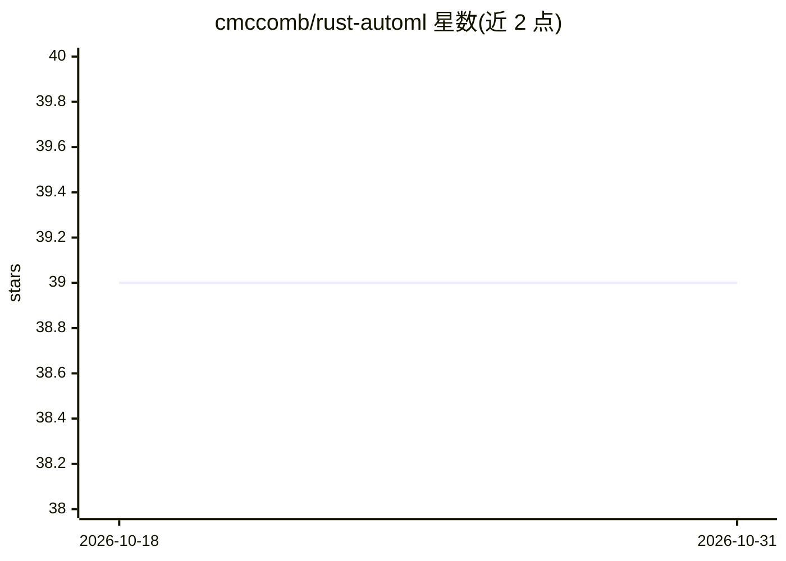

# cmccomb/rust-automl

⭐ 39 · Rust · MIT · 推送 2026-09-20 · [GitHub](https://github.com/cmccomb/rust-automl) · [官网](https://crates.io/crates/automl) · 个人维护

**Rust 自动化机器学习库：训练、比较模型并预测**

基于 SmartCore 估计器与可配置预处理的 Rust AutoML crate：通过交叉验证比较多种回归、分类与聚类模型，训练失败时保留上一次成功模型与拟合的预处理。支持线性/树类/XGBoost 回归、决策树/随机森林/朴素贝叶斯等分类、K-means/DBSCAN 聚类，预处理含缩放、插补、类别编码、PCA/SVD 与多项式特征，拟合的预处理会在推理时复用。以 crates.io 包形式提供给 Rust 开发者，附带示例与 CSV 加载工具。

## 筛选速览

| 维度 | 判定 | 备注 |
|---|---|---|
| AI 角色 | `ai-native` | 本体是模型或模型工具 |
| 许可风险 | `permissive` | MIT |
| 部署形态 | `library` | 以包/库形式分发 |
| 模型依赖 | — | README 未给出锁定关系 |
| 硬件要求 | — | 无带数字的原话,不猜 |
| 安装摩擦 | `low` | 无编译、无系统依赖或容器化 |
| 成熟度 | — | 结构信号不足 |

## 能力要点

- 交叉验证比较多模型并选用最优模型预测
- 回归/分类/聚类三类算法与丰富预处理管道
- 训练失败时保留上次成功模型与拟合预处理
- 无 feature flag 的 CSV 特征与标签加载

## 适用场景

- 在 Rust 项目中快速比较多种模型并选优预测
- 构建带预处理管道的回归/分类/聚类工作流
- 从 CSV 数据直接训练与预测

## 场景标签

 · 领域:机器学习库

## 证据(README 行号)

> L7: Train, compare, and predict with machine-learning models in Rust, using
> L18: Compare classifiers with cross-validation, inspect their scores, and predict with

## 星数曲线

2026-10-18 39 → 2026-10-31 39（+0）

---
*卡片 v1 · prompt 1.4 · 生成 2026-10-25 · 置信度 high · 依据 README sha `dc82c9a8dc38` · [字段定义](../../DATASET.md)*
