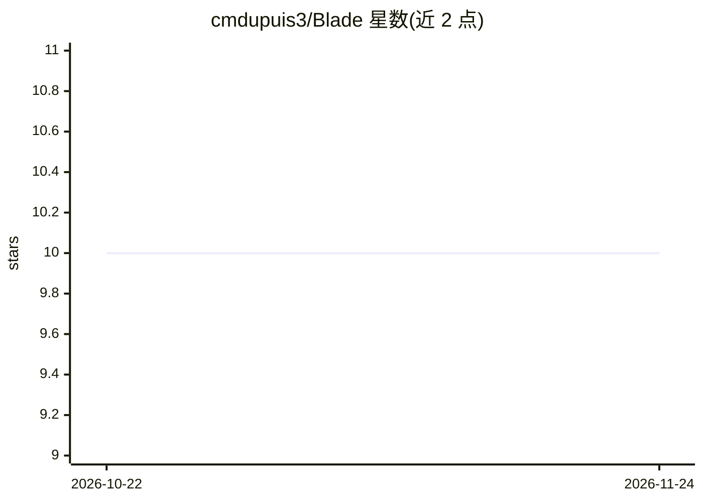

# cmdupuis3/Blade

⭐ 10 · F# · LGPL-3.0 · 推送 2026-11-23 · [GitHub](https://github.com/cmdupuis3/Blade) · 个人维护

**面向科学与统计计算的数组函数式编程语言**

Blade 是一门通用数组函数式编程语言，主要面向复杂网格结构的数组问题，尤其是对称数组。语法在 ML 风格语法基础上扩展了秩与元数多态、迭代模式作为一等值、由核注解进行对称性推导等机制。编译器仅需 .NET SDK 10 构建，运行程序需带 OpenMP 的 g++；可选依赖包括 BLAS/LAPACK、NetCDF、MPI 与 CUDA，由 blade doctor 探测环境。项目状态为开发中（WIP），前身为 Blade-DSL。

## 筛选速览

| 维度 | 判定 | 备注 |
|---|---|---|
| AI 角色 | `ai-enhanced` | 去掉 AI 部分产品仍成立 |
| 许可风险 | `viral` | LGPL-3.0 |
| 部署形态 | `None` |  |
| 模型依赖 | — | README 未给出锁定关系 |
| 硬件要求 | — | 无带数字的原话,不猜 |
| 安装摩擦 | `high` | 编译与系统依赖俱全 |
| 成熟度 | `idea` | |

## 能力要点

- 秩与元数多态、迭代模式一等值、核注解对称性推导的语法机制
- blade doctor 一条命令探测并报告全部工具链依赖配置
- 可选 OpenBLAS/MKL、NetCDF、MPI、CUDA 后端，未启用时使用自带循环
- 提供 VS Code 扩展与 Blade-REPL（类型推导、工具提示）

## 适用场景

- 编写涉及对称数组与复杂网格结构的科学与统计计算
- 配合 OpenBLAS/MKL 或 CUDA 后端做高性能数组运算
- 处理 NetCDF/Zarr/CSV 格式的地球科学数据

## 场景标签

 · 领域:编程语言/科学计算

## 证据(README 行号)

> L7: Blade is a general purpose array-functional programming language.
> L9: Blade is primarily built to solve array problems with complex grid structures, particularly involving symmetric arra

## 星数曲线

2026-10-22 10 → 2026-11-24 10（+0）

---
*卡片 v1 · prompt 1.4 · 生成 2026-11-19 · 置信度 mid · 依据 README sha `cb353688bcf2` · [字段定义](../../DATASET.md)*
