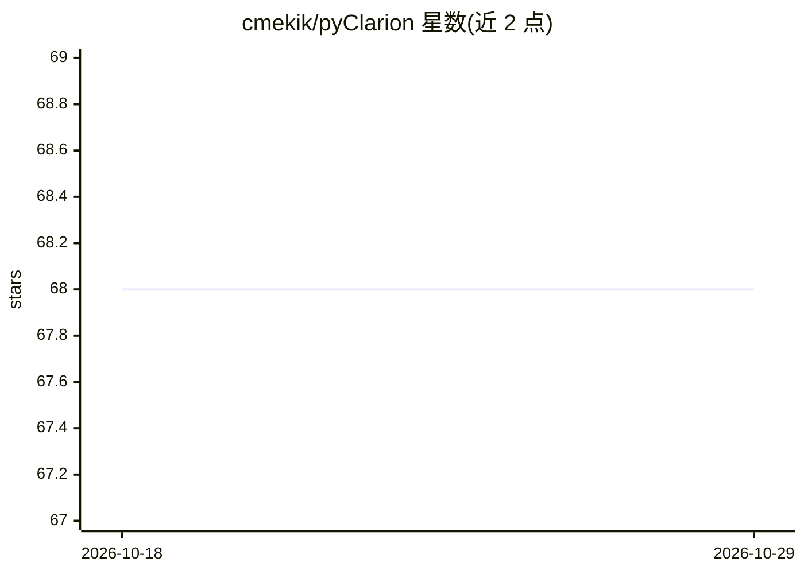

# cmekik/pyClarion

⭐ 68 · Python · MIT · 推送 2026-08-06 · [GitHub](https://github.com/cmekik/pyClarion) · 个人维护

**Clarion 认知架构的实验性 Python 实现库**

用于实现 Clarion 认知架构下 agent 的 Python 包，主要参考 Ron Sun 的《Anatomy of the Mind》。提供模块化模型组装、显式知识初始化的简单语言和数值字典三项核心功能。项目自述为高度实验性，推荐以开发者模式（pip install -e .）从源码目录安装，因源码持续演进；移动安装目录会导致包失效。

## 筛选速览

| 维度 | 判定 | 备注 |
|---|---|---|
| AI 角色 | `ai-ecosystem` | LLM/agent 周边工具 |
| 许可风险 | `permissive` | MIT |
| 部署形态 | `library` | 以包/库形式分发 |
| 模型依赖 | — | README 未给出锁定关系 |
| 硬件要求 | — | 无带数字的原话,不猜 |
| 安装摩擦 | `low` | 无编译、无系统依赖或容器化 |
| 成熟度 | `idea` | |

## 能力要点

- 模块化模型组装
- 显式知识初始化的简单语言
- 数值字典

## 适用场景

- 用 Clarion 架构构建认知 agent
- 认知科学与常识推理的建模实验
- 基于神经符号/神经模糊机制的研究原型

## 场景标签

`Agent 框架` · 领域:Agent 开发

## 证据(README 行号)

> L1: `pyClarion` is a python package for implementing agents in the Clarion cognitive architecture.
> L5: The primary resource for the implementation is Ron Sun's *Anatomy of the Mind*. For a short overview of the architec

## 星数曲线

2026-10-18 68 → 2026-10-29 68（+0）

---
*卡片 v1 · prompt 1.4 · 生成 2026-10-24 · 置信度 mid · 依据 README sha `26f4f140f9af` · [字段定义](../../DATASET.md)*
