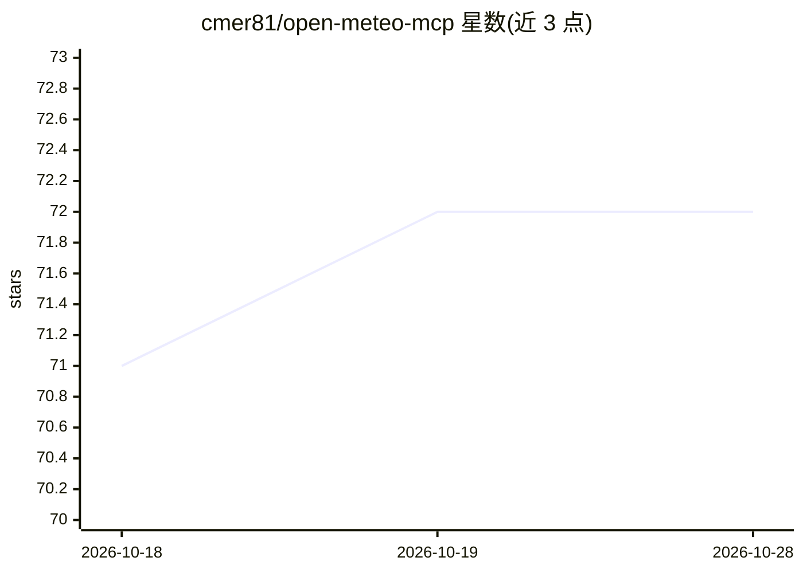

# cmer81/open-meteo-mcp

⭐ 72 · TypeScript · MIT · 推送 2026-10-27 · [GitHub](https://github.com/cmer81/open-meteo-mcp) · [官网](https://www.npmjs.com/package/open-meteo-mcp-server) · 个人维护

**为 LLM 提供天气数据的 MCP 服务器（17 个工具）**

面向 Claude Desktop、Claude Code 及任意 MCP 客户端的 Open-Meteo API 服务器：提供 17 个工具覆盖 16 天预报、ERA5 历史数据（1940 年起）、空气质量、海洋、洪水、季节预报、CMIP6 气候预估及地理编码与高程，另含 7 个气象机构特定模式预报工具。为 LLM 设计严格输入 schema、服务器指令与 25,000 字符截断的 JSON 响应。支持 stdio 与 Streamable HTTP 两种传输，含 API key 鉴权、限流与内存缓存，可经 npx 直接运行或 Docker 部署，Open-Meteo 非商业用途免 API key。

## 筛选速览

| 维度 | 判定 | 备注 |
|---|---|---|
| AI 角色 | `ai-ecosystem` | LLM/agent 周边工具 |
| 许可风险 | `permissive` | MIT |
| 部署形态 | `self-host` | docker 或自建部署 |
| 模型依赖 | locked-api |  |
| 硬件要求 | — | 无带数字的原话,不猜 |
| 安装摩擦 | `low` | 无编译、无系统依赖或容器化 |
| 成熟度 | — | 结构信号不足 |

## 能力要点

- 17 个工具覆盖预报/历史/空气质量/海洋/洪水/气候预估与地理编码
- 为 LLM 设计的严格输入 schema、服务器指令与 25,000 字符响应截断
- stdio 与无状态 Streamable HTTP 双传输，含 API key 鉴权、限流与来源检查
- 内存响应缓存按端点设置 TTL，各 Open-Meteo 端点可指向自建实例

## 适用场景

- 在 Claude 等 MCP 客户端中用自然语言查询天气、历史气候与空气质量
- 远程以 Docker 部署并向多用户提供带鉴权的天气 MCP 服务
- 在自建 Open-Meteo 实例前做 LLM 接入层

## 场景标签

 · 领域:LLM 工具服务/气象数据

## 证据(README 行号)

> L13: A Model Context Protocol server for the free Open-Meteo APIs. Plug it into Claude Desktop, Claude Code or any MCP c
> L25: - **17 tools** covering forecasts, ERA5 history, air quality, marine, flood, seasonal, ensemble and CMIP6 climate d
> L28: - **Two transports**: stdio for local clients, stateless Streamable HTTP for remote deployments, with API key auth,

## 星数曲线

2026-10-18 71 → 2026-10-28 72（+1）

---
*卡片 v1 · prompt 1.4 · 生成 2026-10-24 · 置信度 mid · 依据 README sha `40a1d097b8a6` · [字段定义](../../DATASET.md)*
