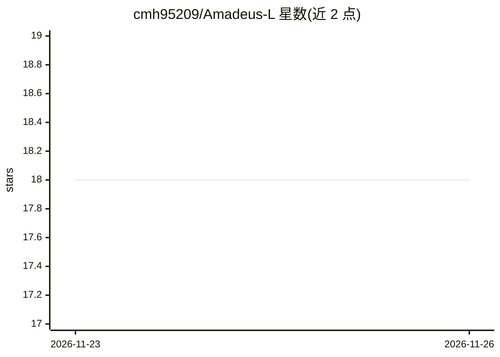

# cmh95209/Amadeus-L

⭐ 18 · Python · MIT · 推送 2026-11-25 · [GitHub](https://github.com/cmh95209/Amadeus-L) · 个人维护

**还原《命运石之门0》Amadeus 的本地 AI 桌面伴侣应用**

受《命运石之门0》启发的 AI 伴侣应用，复刻动画中的 Amadeus 助手：内置可本地运行的对话模型（Gemma 经 llama.cpp），语音采用 GPT-SoVITS，日语原生生成回复再翻译为 17 种显示语言；具备长期记忆（CharacterMemory sidecar、SQLite 本地存储）、图片/视频/文档读取、联网搜索与天气查询、Live2D 角色渲染与唇形同步、信任关系系统。提供 Windows/macOS/Linux 安装器，也支持连接任意 OpenAI 兼容模型服务器或云服务商。

## 筛选速览

| 维度 | 判定 | 备注 |
|---|---|---|
| AI 角色 | `ai-native` | 本体是模型或模型工具 |
| 许可风险 | `permissive` | MIT |
| 部署形态 | `None` |  |
| 模型依赖 | local-ok | 支持本地模型 |
| 硬件要求 | — | 无带数字的原话,不猜 |
| 安装摩擦 | `low` | 无编译、无系统依赖或容器化 |
| 成熟度 | — | 结构信号不足 |

## 能力要点

- 内置本地模型（Gemma 4 经 llama.cpp），安装即用
- 日语原生生成回复后单次调用内翻译为 17 种语言，5 种语音
- 长期记忆 sidecar、本地 SQLite 历史存储、图片/视频/文档读取
- 自动探测本地模型端口，连接测试显示可用模型列表

## 适用场景

- 在自己的电脑上运行一个有长期记忆的动画角色 AI 伴侣
- 用本地模型或自己的 API key 驱动日式语音对话
- 通过手机远程访问桌面上的 Amadeus

## 场景标签

`聊天机器人` · 领域:对话与助手

## 证据(README 行号)

> L15: Amadeus-L is a Steins;Gate 0-inspired AI assistant designed to
> L138:  - a local server on your own GPU (llama.cpp, vLLM, or any OpenAI-compatible server)
> L179: **Yes it can.** The conversational LLM can run **on your own GPU**

## 星数曲线

2026-11-23 18 → 2026-11-26 18（+0）

---
*卡片 v1 · prompt 1.4 · 生成 2026-11-23 · 置信度 high · 依据 README sha `41308d8b7c26` · [字段定义](../../DATASET.md)*
