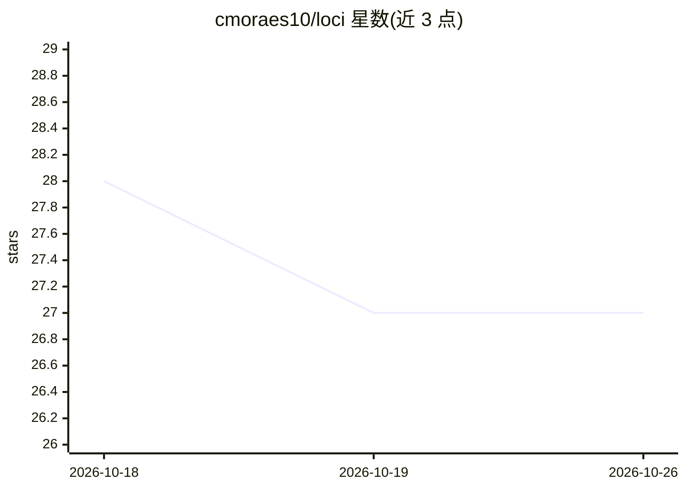

# cmoraes10/loci

⭐ 27 · Python · MIT · 推送 2026-10-01 · [GitHub](https://github.com/cmoraes10/loci) · [官网](https://pypi.org/project/mowave-loci/) · 个人维护

**给 AI agent 的类型化长期记忆层：一个核心加两个适配器**

为 AI agent 提供持久化长期记忆的 Python 库：从对话中提取事实，按 8 个类别、4 个重要性层级与状态生命周期组织，每日合并与衰减（临时事实 24 小时 TTL，已完成目标 90 天过期）。提取走模型与正则双路径，provider 不可用时正则路径仍可运行；注入上限约束每次仅送入 12 条按重要度排序的事实。以 MCP server 和 Hermes 插件两种适配器暴露 remember/recall/forget 工具，存储为本地 SQLite 文件，核心仅依赖标准库。

## 筛选速览

| 维度 | 判定 | 备注 |
|---|---|---|
| AI 角色 | `ai-ecosystem` | LLM/agent 周边工具 |
| 许可风险 | `permissive` | MIT |
| 部署形态 | `library` | 以包/库形式分发 |
| 模型依赖 | — | README 未给出锁定关系 |
| 硬件要求 | — | 无带数字的原话,不猜 |
| 安装摩擦 | `low` | 无编译、无系统依赖或容器化 |
| 成熟度 | — | 结构信号不足 |

## 能力要点

- 8 类别、4 重要性层级、状态生命周期的事实模型与每日合并衰减
- 模型+正则双路径提取，模型优先合并，provider 宕机时正则路径可用
- 注入上限：每次仅注入 12 条按重要度/期限/新鲜度排序的事实
- MCP server 与 Hermes 插件两种适配器，存储为本地 SQLite 文件

## 适用场景

- 让 MCP 客户端或 Hermes 宿主中的 agent 跨会话记住用户事实
- 通过 Python API 直接使用记忆存取、提取与上下文块生成
- 为自建 agent 应用注入长期记忆层（自注入 ModelExtractor）

## 场景标签

`Agent 记忆` · 领域:Agent 开发

## 证据(README 行号)

> L35: ||MCP server|Hermes plugin|
> L45: and Hermes has one (`post_llm_call`). Same core underneath; the Hermes adapter
> L89: |Model calls, API keys, provider SDKs|your app (inject a `ModelExtractor`)|

## 星数曲线

2026-10-18 28 → 2026-10-26 27（-1）

---
*卡片 v1 · prompt 1.4 · 生成 2026-10-26 · 置信度 high · 依据 README sha `154c60298818` · [字段定义](../../DATASET.md)*
