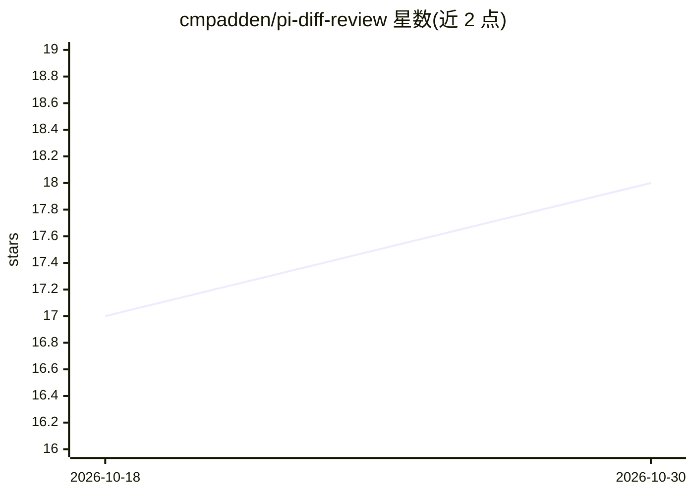

# cmpadden/pi-diff-review

⭐ 18 · TypeScript · MIT · 推送 2026-10-20 · [GitHub](https://github.com/cmpadden/pi-diff-review) · [官网](https://pi.dev/packages/pi-diff-review) · 个人维护

**pi 编码 agent 的 diff 审查扩展：内嵌查看与评注代码变更**

pi 的扩展，在 agent 会话内通过 /diff、/view 命令打开 diff 审查界面：参数透传给 git diff，支持未暂存/已暂存/分支区间/单文件审查，提供分栏渲染、文件侧栏、搜索、行内评注（会话缓存与仓库本地持久化）、按 turn 标记已审的实验模式，并可提交评注回 pi；按 ? 可对当前 hunk 调用 AI 生成解释。通过 npm 或 GitHub 以 pi install 安装。

## 筛选速览

| 维度 | 判定 | 备注 |
|---|---|---|
| AI 角色 | `ai-enhanced` | 去掉 AI 部分产品仍成立 |
| 许可风险 | `permissive` | MIT |
| 部署形态 | `None` |  |
| 模型依赖 | — | README 未给出锁定关系 |
| 硬件要求 | — | 无带数字的原话,不猜 |
| 安装摩擦 | `low` | 无编译、无系统依赖或容器化 |
| 成熟度 | `idea` | |

## 能力要点

- /diff 参数透传 git diff，支持 staged/unstaged/区间/路径过滤
- AI 生成的 hunk 解释（? 键触发）
- 行内与整体评注，会话缓存并持久化到仓库本地存储
- 实验性 --turn-based 模式可标记已审 turn 并以蓝色覆盖显示

## 适用场景

- 在 pi 会话中直接审查当前分支的代码变更并留下评注
- 查看指定文件或目录并逐行标注
- 让 AI 解释 diff 中某段变更的含义

## 场景标签

`代码审查` · 领域:编码与开发

## 证据(README 行号)

> L3:  Embedded code reviews and explanations directly within pi.
> L103: - `?` toggles an AI-generated explanation for the current hunk

## 星数曲线

2026-10-18 17 → 2026-10-30 18（+1）

---
*卡片 v1 · prompt 1.4 · 生成 2026-10-29 · 置信度 high · 依据 README sha `fbf7515b69f6` · [字段定义](../../DATASET.md)*
