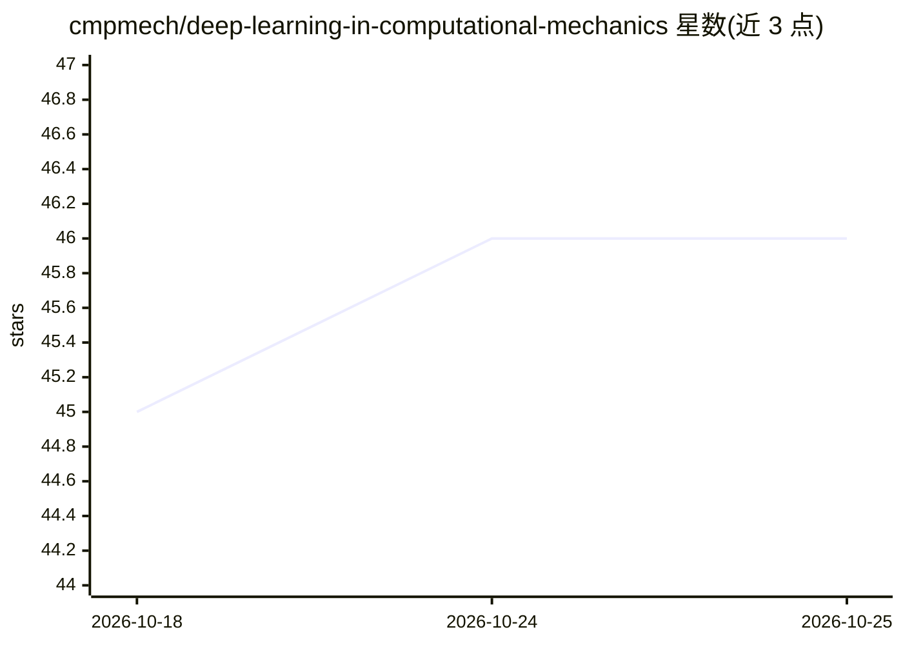

# cmpmech/deep-learning-in-computational-mechanics

⭐ 46 · Jupyter Notebook · 推送 2026-09-18 · [GitHub](https://github.com/cmpmech/deep-learning-in-computational-mechanics) · [官网](https://doi.org/10.1007/978-3-031-89529-6) · 组织维护

**深度学习计算力学教材配套练习、演示与课件**

Springer 2025 出版教材《Deep Learning in Computational Mechanics: An Introductory Course》（第二版）的配套材料库，由作者团队维护。内容分三部分：以 Jupyter notebook 与 Python 文件编写的练习（exercises）、书内短演示 notebook（demos）、PowerPoint 与 pdf 格式的讲义幻灯片（slides）。安装方式为 git clone 或下载 ZIP 后用 conda environment.yml 创建名为 aicome 的环境，通过 JupyterLab 运行，环境中含 torch 等依赖。

## 筛选速览

| 维度 | 判定 | 备注 |
|---|---|---|
| AI 角色 | `ai-knowledge` | 知识聚合/清单类 |
| 许可风险 | `none` | — |
| 部署形态 | `None` |  |
| 模型依赖 | — | README 未给出锁定关系 |
| 硬件要求 | — | 无带数字的原话,不猜 |
| 安装摩擦 | `low` | 无编译、无系统依赖或容器化 |
| 成熟度 | — | 结构信号不足 |

## 能力要点

- 教材配套的 Jupyter notebook 练习与演示
- 提供 PowerPoint 与 pdf 讲义幻灯片
- conda 环境文件一键搭建含 torch 的运行环境

## 适用场景

- 按教材章节动手做计算力学深度学习练习
- 课程教学直接使用配套幻灯片与演示
- 学习有限元/差分与逆问题中的神经网络方法

## 场景标签

`教程课程` · 领域:学习与行业

## 证据(README 行号)

> L1: # Deep Learning in Computational Mechanics: An Introductory Course (supplementary material)
> L9: The material consists of exercises (as Jupyter notebooks and Python files) described in the book (**exercises**), sh

## 星数曲线

2026-10-18 45 → 2026-10-25 46（+1）

---
*卡片 v1 · prompt 1.4 · 生成 2026-10-25 · 置信度 high · 依据 README sha `2ba450c3d254` · [字段定义](../../DATASET.md)*
