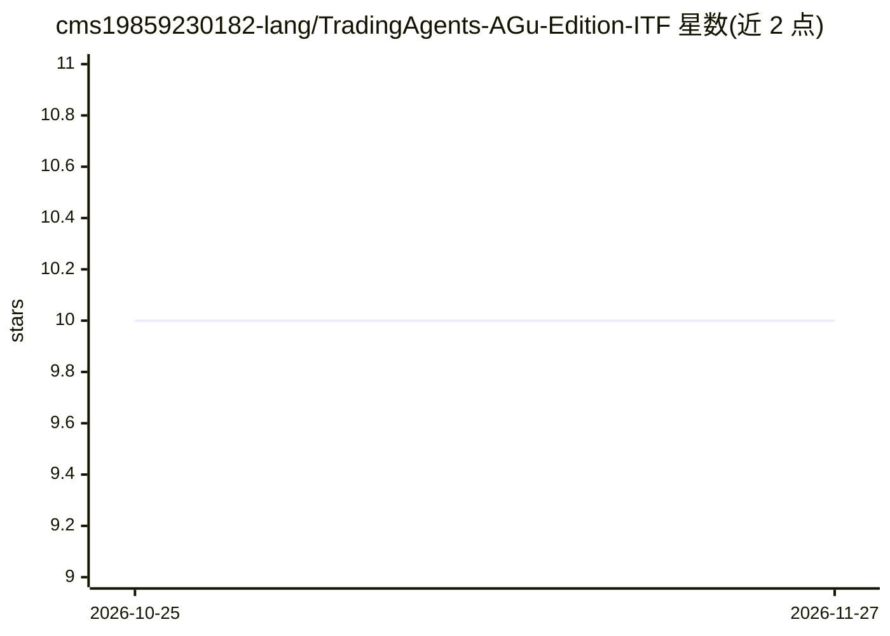

# cms19859230182-lang/TradingAgents-AGu-Edition-ITF

⭐ 10 · Python · Apache-2.0 · 推送 2026-08-10 · [GitHub](https://github.com/cms19859230182-lang/TradingAgents-AGu-Edition-ITF) · 个人维护 · 中文 README

**A 股投资者：多智能体 LLM 投研分析桌面工具**

源自 TauricResearch/TradingAgents 的 A 股特供桌面版，用多智能体协作模拟投研团队：分析师（技术面/情绪/新闻/基本面）分头研究，多空研究员辩论，交易员给建议，风控三视角评估，最终输出五档中文评级。数据走东方财富、Baostock、AKShare 免费公开源，基于 LangGraph 编排，NiceGUI+PyWebView 桌面端为主入口。特色机制包括数据门（真因子不齐拒绝开仓）、分析结束后 @ 角色追问、新闻权重分摊。仅支持上交所/深交所代码，README 声明仅供研究学习，不构成投资建议。

## 筛选速览

| 维度 | 判定 | 备注 |
|---|---|---|
| AI 角色 | `ai-native` | 本体是模型或模型工具 |
| 许可风险 | `permissive` | Apache-2.0 |
| 部署形态 | `desktop` | 安装包/桌面程序 |
| 模型依赖 | local-ok | 支持本地模型 |
| 硬件要求 | — | 无带数字的原话,不猜 |
| 安装摩擦 | `low` | 无编译、无系统依赖或容器化 |
| 成熟度 | — | 结构信号不足 |

## 能力要点

- 多智能体辩论流程：分析师→多空辩论→交易员→风控→投资组合经理五档评级
- 数据门机制：真因子不齐全拒绝开仓，缺失原因可见，防止 LLM 编造数据
- 分析结束后可 @ 指定角色带着上下文继续追问
- LLM 提供商任选（通义/智谱/Kimi/DeepSeek/OpenAI/Gemini/Ollama），数据源无需美股 Key

## 适用场景

- 在桌面端对一只 A 股跑完整多智能体分析并追问细节
- 研究多智能体 LLM 金融框架的架构与实现
- 用免费公开数据源做 A 股基本面与技术面综合研判

## 场景标签

`多智能体` `金融量化` · 领域:Agent 开发

## 证据(README 行号)

> L11: 面向 **A 股** 的桌面端分析系统：多智能体辩论 → 量化评分 → 信号过滤 → 可选追问。本地包名：`invest_the_future`。
> L86: ITF / TradingAgents 用多智能体协作模拟一支投研团队：分析师分头研究，多空研究员辩论，交易员给出建议，风控多视角评估，最终由投资组合经理（财富船长）给出五档评级。
> L234: 基于 LangGraph，包路径为 `invest_the_future`：

## 星数曲线

2026-10-25 10 → 2026-11-27 10（+0）

---
*卡片 v1 · prompt 1.4 · 生成 2026-11-19 · 置信度 high · 依据 README sha `a1163a6664ba` · [字段定义](../../DATASET.md)*
