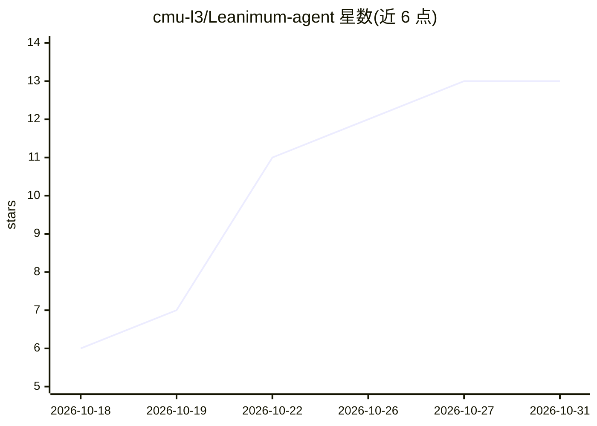

# cmu-l3/Leanimum-agent

⭐ 13 · Python · NOASSERTION · 推送 2026-10-25 · [GitHub](https://github.com/cmu-l3/Leanimum-agent) · [官网](https://cmu-l3.github.io/Leanimum-agent/) · 组织维护

**约百行的极简 bash 代理，用于 Lean 定理证明与编程**

从 mini-SWE-agent fork 而来的最小化 agent：唯一工具是 bash，不依赖 LLM 工具调用接口，动作以独立 subprocess.run 执行，消息历史完全线性，便于沙箱部署、调试与微调。面向 Lean 定理证明与编程任务，提供 leani CLI、批量推理（leani-extra）、轨迹浏览器与 Python 绑定。模型接入经 litellm/openrouter/portkey 支持多种端点；运行环境支持本地、docker/podman、singularity/apptainer 等。由 CMU L3 团队维护，关联 arXiv 论文 ReuF2F。

## 筛选速览

| 维度 | 判定 | 备注 |
|---|---|---|
| AI 角色 | `ai-native` | 本体是模型或模型工具 |
| 许可风险 | `none` | NOASSERTION |
| 部署形态 | `library` | 以包/库形式分发 |
| 模型依赖 | locked-api |  |
| 硬件要求 | — | 无带数字的原话,不猜 |
| 安装摩擦 | `low` | 无编译、无系统依赖或容器化 |
| 成熟度 | — | 结构信号不足 |

## 能力要点

- 唯一工具为 bash，无需 LLM 工具调用接口，可配任意模型
- 动作以独立 subprocess.run 执行，历史完全线性，便于沙箱与微调
- 支持本地/docker/podman/singularity 等多种运行环境
- 提供 CLI、批量推理、轨迹浏览器与 Python 绑定

## 适用场景

- 让 LLM 在 Lean 项目中完成定理证明或编写程序
- 作为定理证明 agent 研究的基线系统
- 在沙箱环境中批量运行并检查 agent 轨迹

## 场景标签

`编码 Agent` `科研工具` · 领域:编码与开发

## 证据(README 行号)

> L3: A minimal bash-only agent for Lean proofs and programs, based on
> L15: - **Does not have any tools other than bash** — it doesn't even need to use the tool-calling interface of the LMs.
> L53: leani -c mini.yaml \

## 星数曲线

2026-10-18 6 → 2026-10-31 13（+7）

---
*卡片 v1 · prompt 1.4 · 生成 2026-10-31 · 置信度 high · 依据 README sha `0563f0b6cb4b` · [字段定义](../../DATASET.md)*
