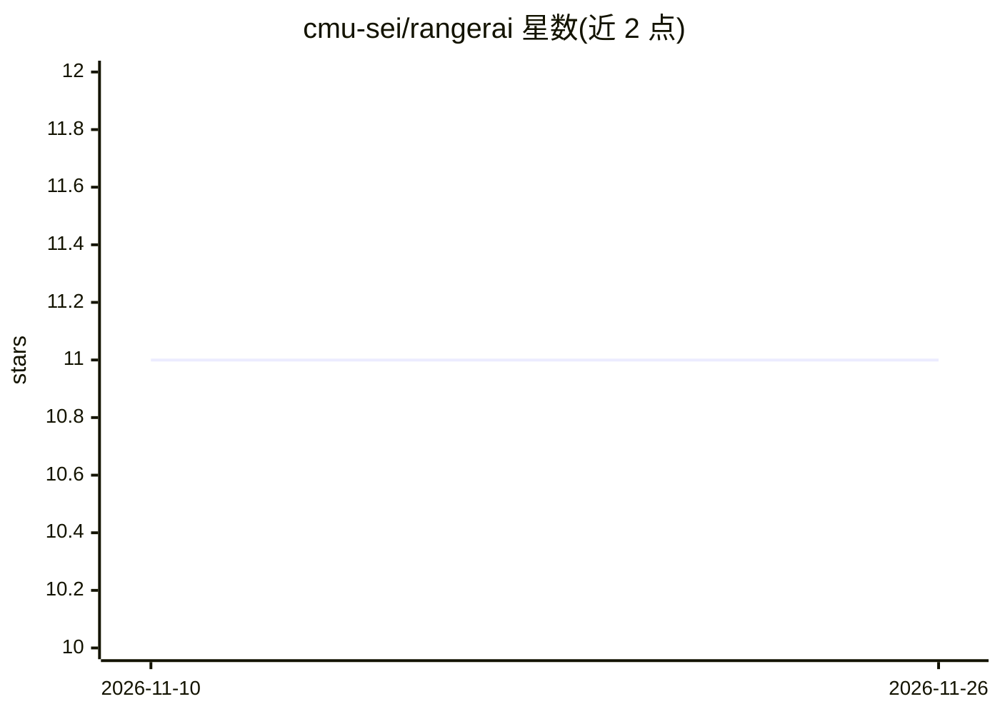

# cmu-sei/rangerai

⭐ 11 · C# · NOASSERTION · 推送 2026-11-20 · [GitHub](https://github.com/cmu-sei/rangerai) · [官网](https://cmu-sei.github.io/rangerai/) · 组织维护

**面向网络靶场训练/演练/实验的自动化编排 AI 基础设施**

由卡内基梅隆大学 SEI 维护，为网络靶场训练、演练与实验提供自动化与编排能力。由三部分组成：Scenario Builder（引导非工程师设计师生成场景 JSON）、Chronicle（事件全过程的统一结构化记录规范与 API）、Range Automation（按记录部署环境、驱动 GHOSTS NPC、触发注入）。可运行于本地或前沿模型，支持封闭与气隙靶场环境，与 SEI 的 Crucible Framework 和 GHOSTS 配合使用。旧 Ranger 栈（chat API、workflows、MCP、appliance）正在退役。

## 筛选速览

| 维度 | 判定 | 备注 |
|---|---|---|
| AI 角色 | `ai-native` | 本体是模型或模型工具 |
| 许可风险 | `none` | NOASSERTION |
| 部署形态 | `None` |  |
| 模型依赖 | — | README 未给出锁定关系 |
| 硬件要求 | — | 无带数字的原话,不猜 |
| 安装摩擦 | `low` | 无编译、无系统依赖或容器化 |
| 成熟度 | `idea` | |

## 能力要点

- Scenario Builder 以 AI agent 辅助非工程背景设计师生成场景 JSON
- Chronicle 提供事件全程统一记录的草案规范（C# 库 + JSON Schema）
- 支持本地或前沿模型，可运行在封闭与气隙网络靶场
- 可见性规则控制 ground truth 不向参与者暴露

## 适用场景

- 为网络攻防演练设计并生成训练场景
- 将演练的方案、环境、注入与复盘统一到一份结构化记录
- 在气隙/封闭靶场环境中运行自动化编排

## 场景标签

`网络安全` `工作流自动化` · 领域:效率与自动化

## 证据(README 行号)

> L3: Ranger is AI infrastructure that helps with automation and orchestration for cyber range training, exercise, and exp
> L13: |Scenario Builder|Experimental|Walks a designer who isn't an engineer through the questions that lead to a good sce
> L19: An exercise today lives in pieces: a scenario document, a network build, injects in a spreadsheet, activity in logs

## 星数曲线

2026-11-10 11 → 2026-11-26 11（+0）

---
*卡片 v1 · prompt 1.4 · 生成 2026-11-18 · 置信度 mid · 依据 README sha `642be940abca` · [字段定义](../../DATASET.md)*
