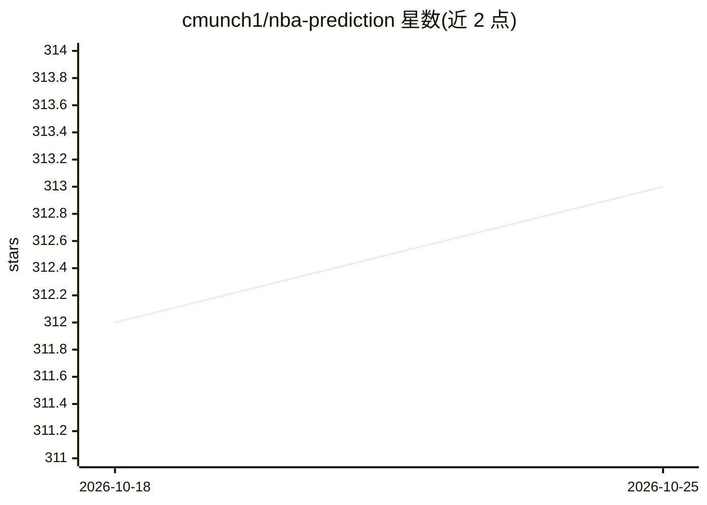

# cmunch1/nba-prediction

⭐ 313 · Jupyter Notebook · 推送 2026-04-01 · [GitHub](https://github.com/cmunch1/nba-prediction) · [官网](https://cmunch1.github.io/nba-prediction/) · 个人维护

**预测 NBA 每日比赛主队胜率的端到端机器学习项目**

作者作为机器学习/数据科学求职作品构建的端到端 ML 部署项目：用 XGBoost/LightGBM 基于滚动统计数据预测每日 NBA 比赛主队获胜概率，经 CalibratedClassifierCV 概率校准后由 Streamlit 应用在线发布。历史数据来自 Kaggle，新数据经 GitHub Actions 每日从 NBA 官网抓取并重训模型；使用 Optuna 调参、Neptune.ai 实验跟踪。作者声明 2024 年 10 月起暂时移除 Hopsworks 特征存储与模型注册功能，项目自述仍在进行中。

## 筛选速览

| 维度 | 判定 | 备注 |
|---|---|---|
| AI 角色 | `ai-native` | 本体是模型或模型工具 |
| 许可风险 | `none` | — |
| 部署形态 | `None` |  |
| 模型依赖 | — | README 未给出锁定关系 |
| 硬件要求 | — | 无带数字的原话,不猜 |
| 安装摩擦 | `low` | 无编译、无系统依赖或容器化 |
| 成熟度 | `idea` | |

## 能力要点

- XGBoost/LightGBM 预测主队胜率并用 CalibratedClassifierCV 校准概率
- GitHub Actions 每日抓取 NBA 数据、更新滚动统计并重训模型
- 避免数据泄漏：仅使用赛前可得数据构造特征
- 以 Streamlit 应用在线发布每日预测

## 适用场景

- 查看每日 NBA 比赛的模型胜率预测
- 学习端到端机器学习部署流程（抓取-训练-部署-监控）
- 作为投注策略开发的概率参考（作者声明仅供洞察补充）

## 场景标签

`数据分析` `网页抓取` · 领域:效率与自动化

## 证据(README 行号)

> L33: Machine learning classification models will be used to predict the probability of the winner of each game based upo
> L41:  - Gradient boosted tree models (Xgboost and LightGBM) will be utilized to determine the probability that the home 

## 星数曲线

2026-10-18 312 → 2026-10-25 313（+1）

---
*卡片 v1 · prompt 1.4 · 生成 2026-10-21 · 置信度 high · 依据 README sha `9263f114bbeb` · [字段定义](../../DATASET.md)*
