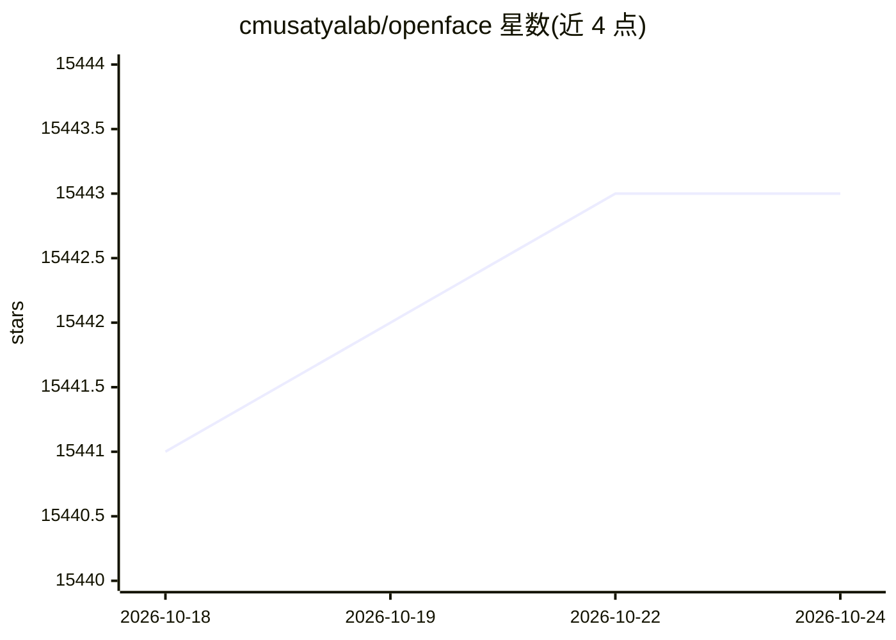

# cmusatyalab/openface

⭐ 15,443 · Lua · Apache-2.0 · 推送 2026-10-14 · [GitHub](https://github.com/cmusatyalab/openface) · [官网](http://cmusatyalab.github.io/openface/) · 组织维护

**基于深度神经网络的开源人脸识别库（CMU）**

Carnegie Mellon University 发布的开源人脸识别研究项目，以深度神经网络生成人脸表示。仓库提供批量图像表示生成（batch-represent）、双图对比、分类器训练与使用、摄像头实时分类等 demo，附带 LFW 精度评估脚本、Python 库代码、模型训练脚本与测试。安装与使用讨论通过 gitter/mailing list 支持；源码与训练模型默认采用 Apache 2.0 许可，包含多个修改过的第三方组件。

## 筛选速览

| 维度 | 判定 | 备注 |
|---|---|---|
| AI 角色 | `ai-ecosystem` | LLM/agent 周边工具 |
| 许可风险 | `permissive` | Apache-2.0 |
| 部署形态 | `None` |  |
| 模型依赖 | — | README 未给出锁定关系 |
| 硬件要求 | — | 无带数字的原话,不猜 |
| 安装摩擦 | `low` | 无编译、无系统依赖或容器化 |
| 成熟度 | — | 结构信号不足 |

## 动量与使用信号

- 维护:`active` — 距上次 push 3.4 天,年发版 0,29 位贡献者
- 涨星:近 1 天 **+0**(自 20261016 起算)
- 安装:github 包 `release-assets` 月下载无数据

## 能力要点

- 提供 Python 库及批量表示生成、对比、分类器训练等脚本
- 包含 LFW 精度评估脚本与网络输出可视化 demo
- 支持 webcam 实时分类器与实时 web demo
- 附训练新模型脚本与含神经网络训练的测试

## 适用场景

- 对批量人脸图像生成深度神经网络表示
- 训练并部署自己的人脸分类器
- 在 LFW 上评估人脸识别精度

## 场景标签

`人脸识别` · 领域:感知与多模态

## 证据(README 行号)

> L3: *Free and open source face recognition with
> L33: + openface: Python library code.
> L54: model files are copyright Carnegie Mellon University and licensed

## 星数曲线

2026-10-18 15,441 → 2026-10-24 15,443（+2）

---
*卡片 v1 · prompt 1.4 · 生成 2026-10-18 · 置信度 high · 依据 README sha `8176ec0314e5` · [字段定义](../../DATASET.md)*
