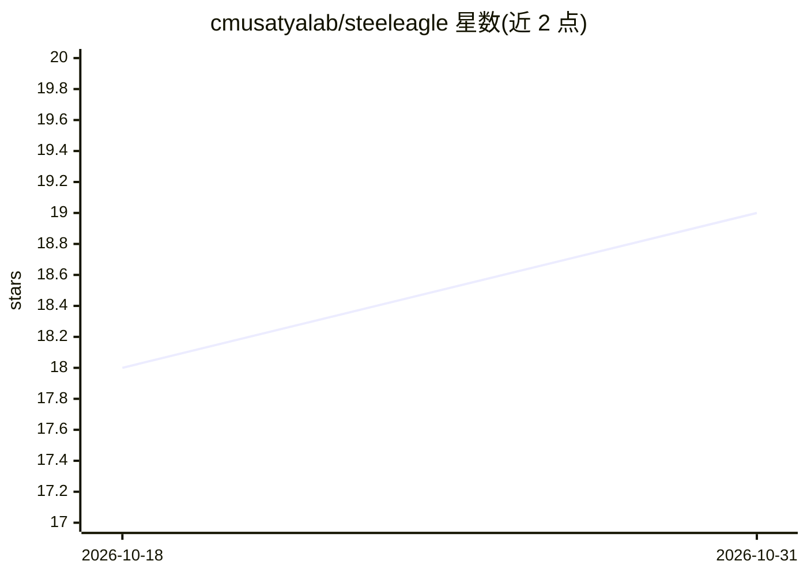

# cmusatyalab/steeleagle

⭐ 19 · Python · GPL-2.0 · 推送 2026-10-30 · [GitHub](https://github.com/cmusatyalab/steeleagle) · [官网](https://cmusatyalab.github.io/steeleagle/) · 组织维护

**将商用无人机接入边缘算力的自主飞行软件套件**

面向 COTS 商用机器人平台的软件套件与边缘编排系统：通过统一 API 屏蔽各家控制 SDK 差异，把机器智能放到边缘服务器上运行，使轻量廉价硬件承载自主飞行。提供可视化任务脚本工具（无需编程）、Task Creator SDK 与 Backend SDK（跨机队部署 AI 模型），支持异构机器人群协作与 BVLOS 超视距通信（含 LTE）。README 声明性能不及专用自主系统。项目来自 CMU satyalab，附三篇 SEC/MobiSys 论文。

## 筛选速览

| 维度 | 判定 | 备注 |
|---|---|---|
| AI 角色 | `ai-ecosystem` | LLM/agent 周边工具 |
| 许可风险 | `viral` | GPL-2.0 |
| 部署形态 | `None` |  |
| 模型依赖 | — | README 未给出锁定关系 |
| 硬件要求 | — | 无带数字的原话,不猜 |
| 安装摩擦 | `low` | 无编译、无系统依赖或容器化 |
| 成熟度 | — | 结构信号不足 |

## 能力要点

- 统一 API 屏蔽异构机器人控制 SDK，支持自定义硬件
- 边缘处理管线可即插即用配置 AI 后端，机载无需重算力
- 可视化任务脚本工具面向非程序员，另提供 Task Creator/Backend SDK
- 支持异构机群协作与 LTE 等多种链路的 BVLOS 运行

## 适用场景

- 在廉价商用无人机上做视觉巡检等自主飞行任务
- 非程序员用可视化脚本编排复杂任务行为
- 快速迭代并现场部署 AI 机器人应用

## 场景标签

`工作流自动化` · 领域:效率与自动化

## 证据(README 行号)

> L7: SteelEagle is a software suite and edge orchestration system that transforms
> L22: SteelEagle's edge processing pipelines allow drop-in drop-out configuration of
> L46: Creator SDK to easily build out new functionality, and can use the Backend SDK

## 星数曲线

2026-10-18 18 → 2026-10-31 19（+1）

---
*卡片 v1 · prompt 1.4 · 生成 2026-10-29 · 置信度 high · 依据 README sha `e852af6149fe` · [字段定义](../../DATASET.md)*
