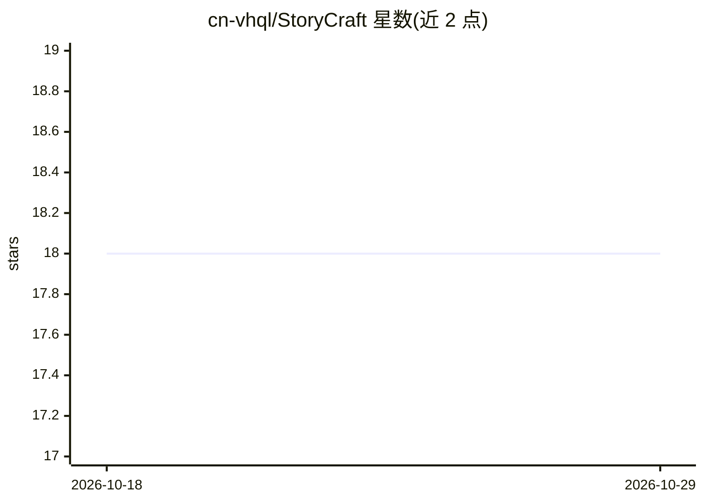

# cn-vhql/StoryCraft

⭐ 18 · Python · MIT · 推送 2026-03-07 · [GitHub](https://github.com/cn-vhql/StoryCraft) · 个人维护 · 中文 README

**为 3-5 岁儿童生成 AI 图文绘本并导出 Kindle PDF 的工具**

基于 Streamlit 的 Web 应用：输入故事创意与角色名，调用通义千问生成中文故事（可编辑），自动翻译为英文并逐页生成插图，支持 8 种画风与多种图片尺寸，最终经 ReportLab 生成适配 Kindle 与平板的 PDF。需要 Python 3.11+ 与通义千问或豆包的 API Key（通义千问有免费档）。生成文件按时间戳目录存于 output/。README 声明内容全部由 AI 生成，建议家长先行审阅。

## 筛选速览

| 维度 | 判定 | 备注 |
|---|---|---|
| AI 角色 | `ai-native` | 本体是模型或模型工具 |
| 许可风险 | `permissive` | MIT |
| 部署形态 | `library` | 以包/库形式分发 |
| 模型依赖 | — | README 未给出锁定关系 |
| 硬件要求 | — | 无带数字的原话,不猜 |
| 安装摩擦 | `low` | 无编译、无系统依赖或容器化 |
| 成熟度 | — | 结构信号不足 |

## 能力要点

- 输入创意生成完整中文故事，可逐页编辑
- 自动中译英并逐页生成插图，8 种画风可选
- 导出适配 Kindle 电子墨水屏与平板的 PDF
- 支持通义千问与豆包两种 AI 服务，可切换图片生成服务

## 适用场景

- 家长为孩子生成个性化睡前绘本
- 教育者制作双语教学材料
- 自制故事书导出 PDF 在 Kindle 上阅读

## 场景标签

`AI 写作` `图像生成` · 领域:内容生成

## 证据(README 行号)

> L3: > AI-powered children's picture book generator for ages 3-5
> L22: - **AI Story Generation** - Enter a creative idea, AI crafts a complete story
> L23: - **Automatic Illustrations** - Beautiful images for every page

## 星数曲线

2026-10-18 18 → 2026-10-29 18（+0）

---
*卡片 v1 · prompt 1.4 · 生成 2026-10-29 · 置信度 mid · 依据 README sha `801c51d9dd0b` · [字段定义](../../DATASET.md)*
