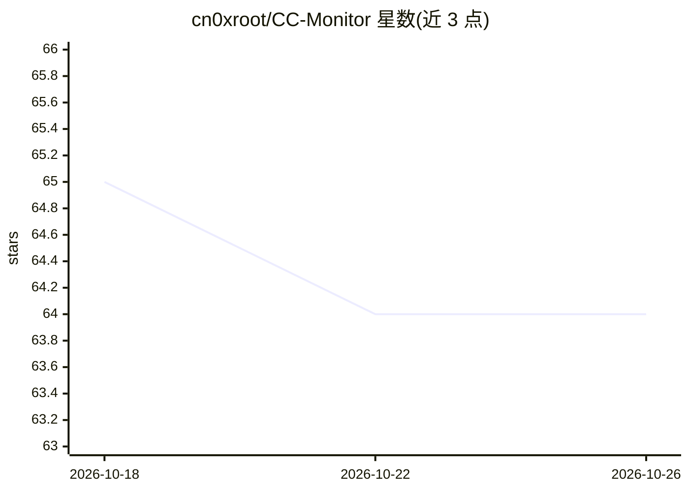

# cn0xroot/CC-Monitor

⭐ 64 · JavaScript · MIT · 推送 2026-09-28 · [GitHub](https://github.com/cn0xroot/CC-Monitor) · [官网](www.cc-monitor.com) · 个人维护 · 中文 README

**监控并审计 Claude Code 在本机行为的工具，高风险操作可拦截**

面向在本地使用 AI 编程 agent 的用户：通过 Claude Code hooks 与 Linux eBPF / macOS nettop 系统层探针双层交叉监控文件读写、shell 命令与网络访问，内置 86 条检测规则并按风险分级（高风险直接阻断、中风险弹确认、低风险记录），全部工具调用落盘 SQLite 审计日志，绕过检测可发现。提供 Web UI 仪表盘（批准台、会话审计、网络轨迹地图）与三级干预模式（Enforcing/Permissive/Off）。master 分支仅支持 Claude Code，dev 分支对 Codex CLI、Gemini CLI、Cursor 等其他 agent 的支持处于实验阶段。

## 筛选速览

| 维度 | 判定 | 备注 |
|---|---|---|
| AI 角色 | `ai-ecosystem` | LLM/agent 周边工具 |
| 许可风险 | `permissive` | MIT |
| 部署形态 | `self-host` | docker 或自建部署 |
| 模型依赖 | — | README 未给出锁定关系 |
| 硬件要求 | — | 无带数字的原话,不猜 |
| 安装摩擦 | `low` | 无编译、无系统依赖或容器化 |
| 成熟度 | `idea` | |

## 能力要点

- hooks 与 eBPF/nettop 系统层探针双层独立交叉验证
- 86 条内置规则按风险三级处置（阻断/确认/记录）
- SQLite 全量审计日志与 CC-Monitor tail 实时视图
- 跨工作目录行为检测与内核级 connect() 目的地捕获（含 GeoIP 世界地图）

## 适用场景

- 让 AI agent 写代码时清楚知道它对机器做了什么
- 阻断 rm -rf、反弹 shell、写 SSH 密钥等高危操作
- 事后审计 AI agent 的完整操作记录与网络轨迹

## 场景标签

`网络安全` `LLM 可观测性` · 领域:评测与运维

## 证据(README 行号)

> L37: - **Two independent layers of monitoring**: Claude Code hooks capture semantic detail; a
> L40: - **86 built-in detection rules, auto-triaged by risk**: high-risk operations get blocked
> L43: - **Full audit trail**: every tool call's command, path, arguments, and decision are logged to

## 星数曲线

2026-10-18 65 → 2026-10-26 64（-1）

---
*卡片 v1 · prompt 1.4 · 生成 2026-10-24 · 置信度 mid · 依据 README sha `1bc90bb490f0` · [字段定义](../../DATASET.md)*
