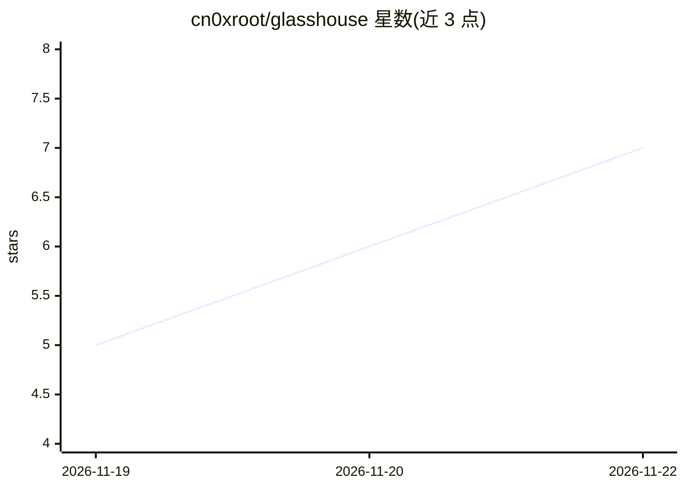

# cn0xroot/glasshouse

⭐ 7 · Go · 推送 2026-11-20 · [GitHub](https://github.com/cn0xroot/glasshouse) · [官网](https://www.sistudiohq.com) · 个人维护 · 中文 README

**为 AI agent 提供硬件级隔离 Ubuntu VM 沙箱**

在 QEMU/KVM（Linux）或 Virtualization.framework（macOS）虚拟化的 Ubuntu 26.04 VM 中运行 AI agent，使其无法接触宿主机文件、凭据与内网。项目打包项目文件（跳过 .env/.pem 等密钥）导入 /workspace，变更经 diff 审查后由 glasshouse pull 写回；出站流量经宿主侧域名白名单代理，私网/元数据地址被阻断；模型 API key 留在宿主，VM 内仅持有会话令牌；审计日志 hash 链防篡改。提供 --shell 轻量模式与 --gui GNOME 桌面模式，镜像预装 Claude Code 与 CC-Monitor。

## 筛选速览

| 维度 | 判定 | 备注 |
|---|---|---|
| AI 角色 | `ai-ecosystem` | LLM/agent 周边工具 |
| 许可风险 | `none` | — |
| 部署形态 | `None` |  |
| 模型依赖 | locked-api |  |
| 硬件要求 | — | 无带数字的原话,不猜 |
| 安装摩擦 | `low` | 无编译、无系统依赖或容器化 |
| 成熟度 | — | 结构信号不足 |

## 能力要点

- VM 级隔离：边界为 hypervisor，无共享目录、无真实网卡
- 变更经审查导出：glasshouse pull 展示 diff，仅写回批准内容
- API key 留宿主的 LLM 网关机制，或 VM 内订阅账号登录
- hash 链审计日志（glasshouse logs --verify），日志不可写即拒绝操作

## 适用场景

- 让 Claude Code 长时间自动执行命令而不危及宿主机
- vibe coding 结束后审查并选择性取回 agent 的改动
- 通过域名白名单与出口字节上限约束 agent 网络行为

## 场景标签

`编码 Agent` · 领域:编码与开发

## 证据(README 行号)

> L5: Run AI agents inside a hardware-virtualized Ubuntu 26.04 LTS virtual machine, so they cannot reach your host's files
> L40: - **VM-level isolation**: the agent runs in its own Ubuntu 26.04 VM. The boundary is the hypervisor, not a containe
> L43: - **Two ways to use Claude**: either an API key that stays on the host (the guest holds only a session token that t

## 星数曲线

2026-11-19 5 → 2026-11-22 7（+2）

---
*卡片 v1 · prompt 1.4 · 生成 2026-11-21 · 置信度 high · 依据 README sha `c6ac5f787792` · [字段定义](../../DATASET.md)*
