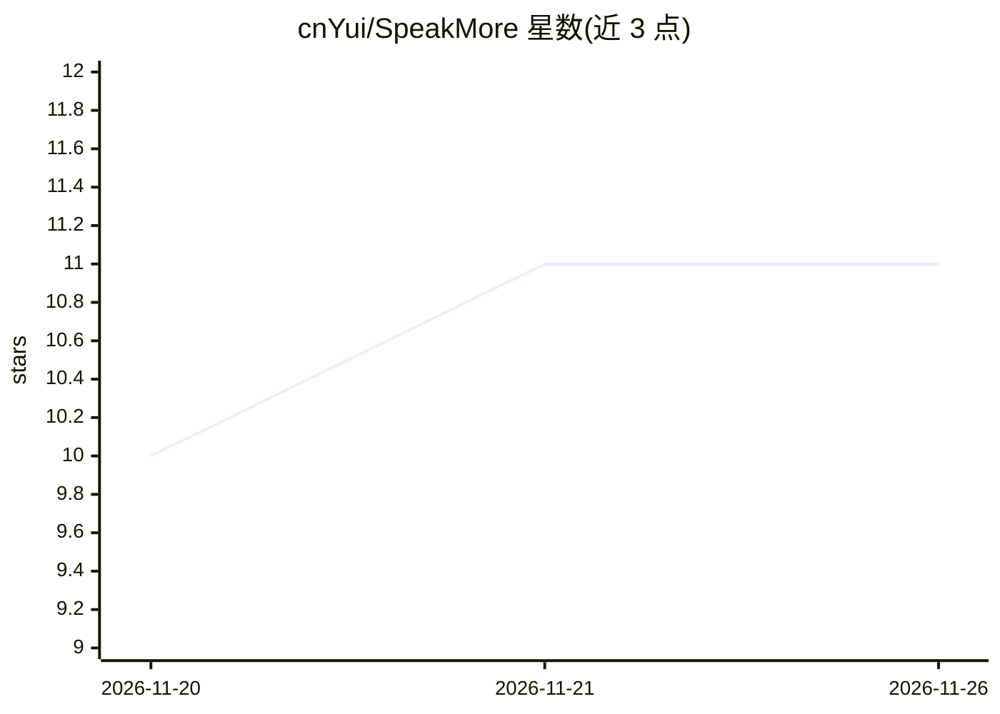

# cnYui/SpeakMore

⭐ 11 · JavaScript · MIT · 推送 2026-11-24 · [GitHub](https://github.com/cnYui/SpeakMore) · 个人维护 · 中文 README

**Windows/macOS 本地语音输入工具：快捷键说话转文字并自动粘贴**

以 Electron 为桌面壳、本地 FastAPI 为后端的语音输入工具：按快捷键录音后经本地 SenseVoiceSmall 模型转写，可选接入大模型 API 做润色、翻译或自由提问，结果自动粘贴到光标处或显示在悬浮面板。支持 PyTorch 与 int8 ONNX 两版模型下载切换，运行设备可选 CUDA/MPS/CPU。历史、词典、设置均只存本机。普通用户从 GitHub Releases 下载产物使用；开发者需 Node.js 与 Python 环境从源码构建，大模型功能需自行填写 API Key。

## 筛选速览

| 维度 | 判定 | 备注 |
|---|---|---|
| AI 角色 | `ai-native` | 本体是模型或模型工具 |
| 许可风险 | `permissive` | MIT |
| 部署形态 | `desktop` | 安装包/桌面程序 |
| 模型依赖 | locked-api |  |
| 硬件要求 | — | 无带数字的原话,不猜 |
| 安装摩擦 | `medium` | 含编译或系统依赖之一 |
| 成熟度 | — | 结构信号不足 |

## 能力要点

- 本地 SenseVoiceSmall 转写，PyTorch 与 int8 ONNX（sherpa-onnx）两版可切换
- 听写、自由提问、语音翻译三种快捷键模式，结果自动粘贴到光标处
- 大模型 API 配置经设置页填写，provider 与密钥存于本机 settings.json
- 运行设备可选 CUDA / MPS / CPU，并回退机制与原因查询接口

## 适用场景

- 在任意输入框按快捷键口述文字替代键盘打字
- 选中一段文本后语音提问并携带上下文获取回答
- 语音内容翻译后直接粘贴到当前光标位置
- 离线环境下预先准备模型目录后本地转写

## 场景标签

`语音识别` · 领域:感知与多模态

## 证据(README 行号)

> L3: SpeakMore 是一个本地语音输入工具。Electron 负责桌面壳、固定快捷键、托盘、本地数据和结果交付；本地 FastAPI 后端负责音频转写和大模型文本处理。Windows 是当前稳定版，macOS 已支持本地 `.app
> L16: - Windows `Right Alt` / macOS `Option`：听写，结果自动粘贴；无法确认可信输入目标时显示悬浮面板。
> L37: 模型不打包。首次运行需要联网下载 SenseVoiceSmall，Windows 默认缓存到 `%LOCALAPPDATA%\Typeless\models\funasr`，macOS 默认缓存到 `~/Library/Appli

## 星数曲线

2026-11-20 10 → 2026-11-26 11（+1）

---
*卡片 v1 · prompt 1.4 · 生成 2026-11-20 · 置信度 mid · 依据 README sha `2958dae3fd4c` · [字段定义](../../DATASET.md)*
