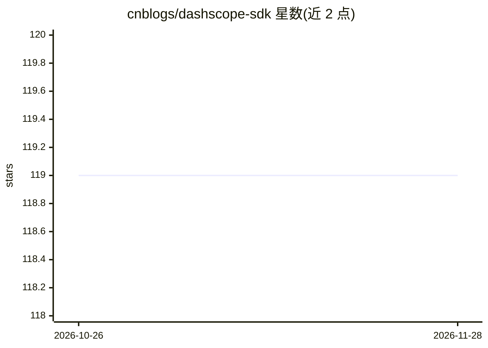

# cnblogs/dashscope-sdk

⭐ 119 · C# · MIT · 推送 2026-11-27 · [GitHub](https://github.com/cnblogs/dashscope-sdk) · [官网](https://www.nuget.org/packages/Cnblogs.DashScope.AspNetCore) · 组织维护 · 中文 README

**.NET 开发者访问阿里云百炼 DashScope 服务的非官方 SDK**

Cnblogs 维护的非官方 DashScope（百炼）服务 .NET SDK，提供三个 NuGet 包：控制台用的 Cnblogs.DashScope.Sdk、ASP.NET Core 集成包，以及实现 Microsoft.Extensions.AI IChatClient 接口的 Cnblogs.DashScope.AI。覆盖文本生成、多模态、语音识别/合成、图像与视频生成、嵌入、重排等 API 类别；内置多模态/文本端点白名单映射、区域与业务空间（workspace）端点切换、内容检查请求头配置。README 提示项目仍在积极开发中，小版本也可能出现破坏性变更。

## 筛选速览

| 维度 | 判定 | 备注 |
|---|---|---|
| AI 角色 | `ai-ecosystem` | LLM/agent 周边工具 |
| 许可风险 | `permissive` | MIT |
| 部署形态 | `None` |  |
| 模型依赖 | — | README 未给出锁定关系 |
| 硬件要求 | — | 无带数字的原话,不猜 |
| 安装摩擦 | `low` | 无编译、无系统依赖或容器化 |
| 成熟度 | `idea` | |

## 能力要点

- 三个 NuGet 包分别覆盖控制台、ASP.NET Core 依赖注入与 Microsoft.Extensions.AI IChatClient 接口
- 覆盖文本生成、多模态、TTS、ASR、图像/视频/3D 生成、嵌入、重排等 API 类别
- 内置多模态/文本端点白名单映射与 AutoSyncModelList 自动查询模型列表
- 支持多区域（北京/新加坡/香港等）与业务空间端点切换

## 适用场景

- 在 .NET 应用中调用百炼的文本生成与对话 API
- 通过 IChatClient 接口接入 qwen 系列模型并使用工具调用
- 为 TTS 或流式语音识别应用接入 CosyVoice/Paraformer
- 在企业业务空间（workspace）中管理 API 访问与区域端点

## 场景标签

 · 领域:LLM 基础设施/SDK

## 证据(README 行号)

> L9: A non-official DashScope (Bailian) service SDK maintained by Cnblogs.
> L189: ## Supported APIs
> L53: ### Using `Microsoft.Extensions.AI` Interface

## 星数曲线

2026-10-26 119 → 2026-11-28 119（+0）

---
*卡片 v1 · prompt 1.4 · 生成 2026-11-28 · 置信度 high · 依据 README sha `ead9fb74f2d0` · [字段定义](../../DATASET.md)*
