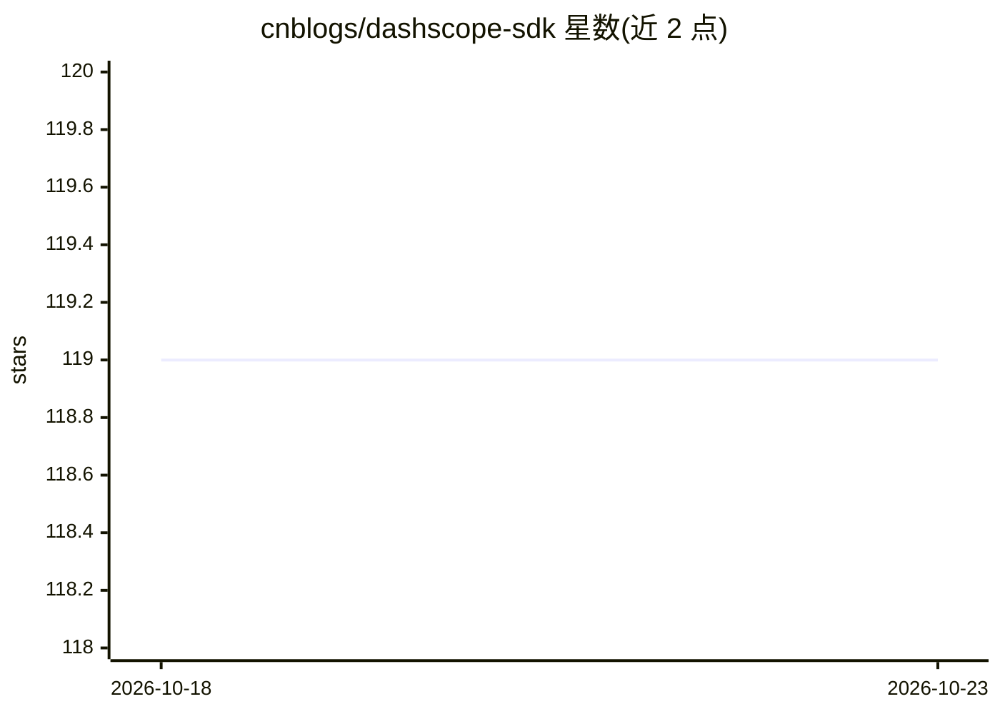

# cnblogs/dashscope-sdk

⭐ 119 · C# · MIT · 推送 2026-10-19 · [GitHub](https://github.com/cnblogs/dashscope-sdk) · [官网](https://www.nuget.org/packages/Cnblogs.DashScope.AspNetCore) · 组织维护 · 中文 README

**面向 .NET 的非官方 DashScope（百炼）服务 SDK**

由博客园团队维护的 .NET SDK，用于接入阿里云 DashScope（百炼）服务，覆盖文本生成、多模态、语音合成、图像生成、应用调用、Batch 与文本嵌入等 API。提供 Console 与 ASP.NET Core 两种接入方式，并额外提供 Cnblogs.DashScope.AI 包以实现 Microsoft.Extensions.AI 的 IChatClient 接口，支持流式输出、思考模型、工具调用、结构化输出、联网搜索、代码解释器、OCR 与 PPT 生成等能力。README 声明项目仍在积极开发中，次要版本也可能出现破坏性变更。

## 筛选速览

| 维度 | 判定 | 备注 |
|---|---|---|
| AI 角色 | `ai-ecosystem` | LLM/agent 周边工具 |
| 许可风险 | `permissive` | MIT |
| 部署形态 | `None` |  |
| 模型依赖 | — | README 未给出锁定关系 |
| 硬件要求 | — | 无带数字的原话,不猜 |
| 安装摩擦 | `low` | 无编译、无系统依赖或容器化 |
| 成熟度 | `idea` | |

## 能力要点

- 覆盖文本生成、多模态、TTS、图像生成、Batch、嵌入等 DashScope API
- 提供 Microsoft.Extensions.AI 的 IChatClient 适配包（AsChatClient）
- 支持流式输出、思考模型（ReasoningContent/ThinkingBudget）、工具调用与 JSON 结构化输出
- 支持文件上传（可限速）、OCR 高级识别与 qwen-doc-turbo PPT 生成

## 适用场景

- 在 .NET 应用中调用 DashScope 上的 Qwen 等模型
- 通过 Microsoft.Extensions.AI 标准接口在 ASP.NET Core 中接入大模型
- 构建带工具调用、联网搜索或代码解释器的对话应用

## 场景标签

 · 领域:LLM 基础设施/API SDK

## 证据(README 行号)

> L9: A non-official DashScope (Bailian) service SDK maintained by Cnblogs.
> L58: var client = new DashScopeClient("your-api-key").AsChatClient("qwen-max");

## 星数曲线

2026-10-18 119 → 2026-10-23 119（+0）

---
*卡片 v1 · prompt 1.4 · 生成 2026-10-23 · 置信度 high · 依据 README sha `26e37e6dc8bc` · [字段定义](../../DATASET.md)*
