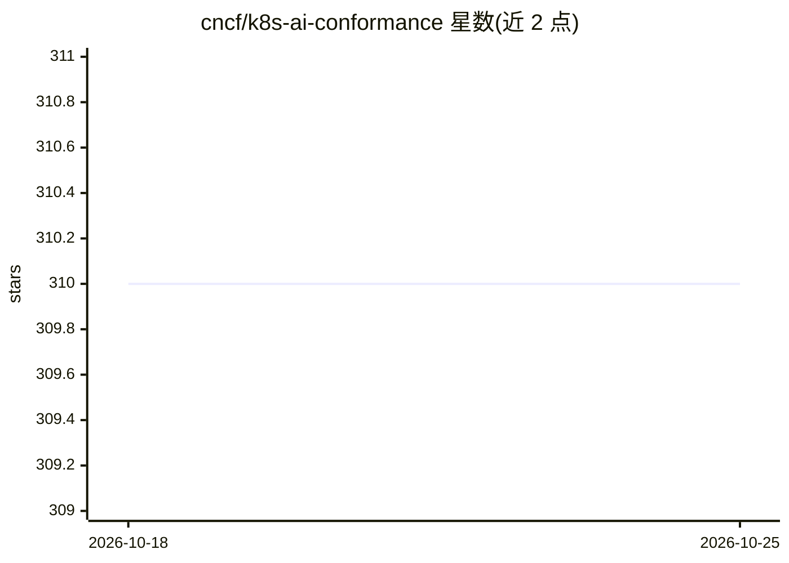

# cncf/k8s-ai-conformance

⭐ 310 · Go · Apache-2.0 · 推送 2026-10-15 · [GitHub](https://github.com/cncf/k8s-ai-conformance) · 组织维护

**CNCF 的 Kubernetes AI 负载一致性认证项目**

由 CNCF 维护的 Kubernetes AI Conformance 认证项目：定义 Kubernetes 平台可靠运行 AI/ML 工作负载（训练、推理、Agentic）所需的能力基线，覆盖加速器、网络、调度、可观测性、安全与 Operator 支持等要求。面向平台厂商提交一致性清单 YAML 与证据 PR，v1.37 起支持自动化测试结果加人工声明的混合验证；认证按产品与配置颁发，有效期一年，前提是已通过基础 Kubernetes 一致性认证。

## 筛选速览

| 维度 | 判定 | 备注 |
|---|---|---|
| AI 角色 | `ai-ecosystem` | LLM/agent 周边工具 |
| 许可风险 | `permissive` | Apache-2.0 |
| 部署形态 | `None` |  |
| 模型依赖 | — | README 未给出锁定关系 |
| 硬件要求 | — | 无带数字的原话,不猜 |
| 安装摩擦 | `low` | 无编译、无系统依赖或容器化 |
| 成熟度 | — | 结构信号不足 |

## 能力要点

- 定义 AI/ML 工作负载在 Kubernetes 上的可移植性能力基线
- v1.37+ 支持 automated tests 加 manual attestation 的混合验证
- 认证有效期一年，per-product / per-configuration 颁发
- 要求先通过基础 Kubernetes Conformance

## 适用场景

- Kubernetes 平台厂商申请 AI 负载一致性认证
- AI 工具生态以统一基线做构建与测试
- 最终用户核对已认证的 Kubernetes 平台

## 场景标签

 · 领域:云原生/AI 基础设施标准

## 证据(README 行号)

> L18: The Kubernetes AI Conformance Program defines the capabilities a Kubernetes platform needs to reliably run AI and m
> L22: AI/ML workloads tend to stress clusters in unique ways (accelerators, bursty traffic, and strict isolation). Today,

## 星数曲线

2026-10-18 310 → 2026-10-25 310（+0）

---
*卡片 v1 · prompt 1.4 · 生成 2026-10-21 · 置信度 high · 依据 README sha `596ac24f119b` · [字段定义](../../DATASET.md)*
