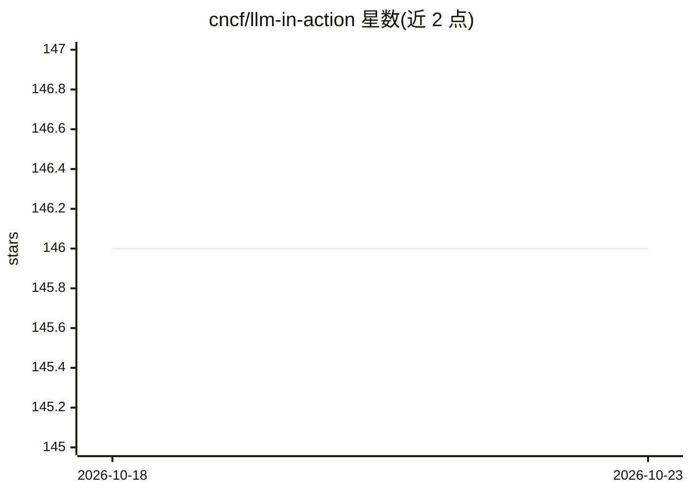

# cncf/llm-in-action

⭐ 146 · Python · Apache-2.0 · 推送 2026-03-09 · [GitHub](https://github.com/cncf/llm-in-action) · 组织维护

**CNCF 出品的 LLM 应用上 Kubernetes 演示教程**

由 CNCF 维护的云原生演示仓库：通过 startup.sh 脚本创建 kind 集群、应用 Kubernetes manifests 并做端口转发，让用户在浏览器（localhost:8501）中拍照并用 LLaVa 模型生成图片描述。前置依赖为 Docker、Ollama、kind 与 kubectl，需先用 ollama pull 拉取 llava 模型（约 4.7GB）。提供 shutdown.sh 清理集群，声明在 macOS/Linux/Windows 上测试通过。属于教学演示性质，非可复用库或框架。

## 筛选速览

| 维度 | 判定 | 备注 |
|---|---|---|
| AI 角色 | `ai-knowledge` | 知识聚合/清单类 |
| 许可风险 | `permissive` | Apache-2.0 |
| 部署形态 | `None` |  |
| 模型依赖 | local-ok | 支持本地模型 |
| 硬件要求 | — | 无带数字的原话,不猜 |
| 安装摩擦 | `low` | 无编译、无系统依赖或容器化 |
| 成熟度 | — | 结构信号不足 |

## 能力要点

- startup.sh 一键创建 kind 集群并部署演示应用
- 浏览器内拍照并由 LLaVa 生成图片描述
- 前置依赖 Docker、Ollama、kind、kubectl，附 ollama pull llava 拉取步骤
- shutdown.sh 移除 manifests、端口转发并删除 kind 集群

## 适用场景

- 学习如何在 Kubernetes/kind 上运行 LLM 视觉应用
- 体验 LLaVa 模型在云原生环境中的部署流程
- 作为云原生与 LLM 结合的入门演示

## 场景标签

`教程课程` · 领域:学习与行业

## 证据(README 行号)

> L31: We have crafted a few scripts to make this demo run as quickly as possible on your machine once you've installed th
> L37: - Use port-forwarding to help us access our service in the browser so we can take photos and describe them with LLa
> L40: ./startup.sh

## 星数曲线

2026-10-18 146 → 2026-10-23 146（+0）

---
*卡片 v1 · prompt 1.4 · 生成 2026-10-23 · 置信度 mid · 依据 README sha `6f2f5c1c4b1a` · [字段定义](../../DATASET.md)*
