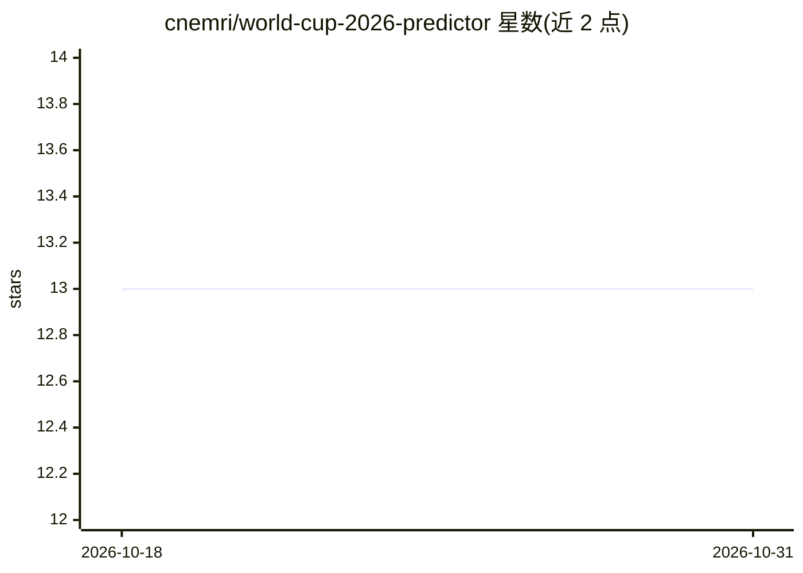

# cnemri/world-cup-2026-predictor

⭐ 13 · Python · MIT · 推送 2026-07-10 · [GitHub](https://github.com/cnemri/world-cup-2026-predictor) · 个人维护

**ML 预测 2026 世界杯冠军：Elo+XGBoost+蒙特卡洛模拟**

基于 1872–2026 年 49,505 场国际比赛的机器学习预测系统：Elo 评分引擎（分级 K 因子、净胜球加权）、17 特征梯度提升分类器加 Platt 概率校准、Poisson 进球模型，以及 50,000 次蒙特卡洛锦标赛模拟，输出各队夺冠概率与单场比分预测。特征构建严格无泄漏，采用逐季滚动回测与两阶段训练，报告 RPS/准确率/对数损失。可选接入 Google TabFM 表格基础模型集成（约 6GB 权重）。以 Python 包形式提供，作者为个人开发者。

## 筛选速览

| 维度 | 判定 | 备注 |
|---|---|---|
| AI 角色 | `ai-native` | 本体是模型或模型工具 |
| 许可风险 | `permissive` | MIT |
| 部署形态 | `library` | 以包/库形式分发 |
| 模型依赖 | — | README 未给出锁定关系 |
| 硬件要求 | — | 无带数字的原话,不猜 |
| 安装摩擦 | `low` | 无编译、无系统依赖或容器化 |
| 成熟度 | — | 结构信号不足 |

## 能力要点

- Elo 引擎 + 校准 XGBoost + Poisson 进球模型的组合管线
- 50,000 次蒙特卡洛锦标赛模拟输出夺冠概率
- 无泄漏特征与逐季 walk-forward 回测评估
- 可选 TabFM 表格基础模型集成，缺失时优雅降级

## 适用场景

- 预测世界杯各队夺冠概率与单场胜负
- 复现或学习体育赛事的量化预测方法论
- 研究时间衰减权重与概率校准对预测的影响

## 场景标签

 · 领域:体育分析/机器学习预测

## 证据(README 行号)

> L3: A calibrated machine-learning system that forecasts the **2026 FIFA World Cup**
> L5: combines a margin-aware **Elo rating engine**, **time-decayed gradient-boosted**
> L7: honest **walk-forward evaluation**, and a vectorised **Monte-Carlo** tournament
> L11: > (France through to the semis), from 50,000 simulations with the XGBoost + TabFM

## 星数曲线

2026-10-18 13 → 2026-10-31 13（+0）

---
*卡片 v1 · prompt 1.4 · 生成 2026-10-31 · 置信度 high · 依据 README sha `dd1dbbbcbaa6` · [字段定义](../../DATASET.md)*
