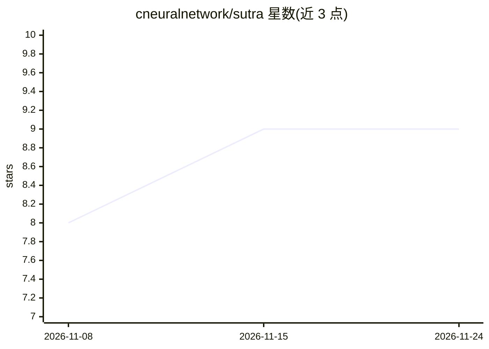

# cneuralnetwork/sutra

⭐ 9 · TypeScript · Apache-2.0 · 推送 2026-11-05 · [GitHub](https://github.com/cneuralnetwork/sutra) · 个人维护

**面向开发者的终端 AI 编码代理：读码、改码、跑测试并报告改动**

运行在终端里的开源编码代理（Apache 2.0，Node.js 22.13+，macOS/Linux）：读取仓库、规划、编辑文件并运行测试直至任务完成。关键机制包括三级权限配置文件（Inspect/Confirm/Flow）、macOS Seatbelt 与 Linux bubblewrap 的 OS 沙箱、按请求的 token 与费用追踪及预算暂停、本地保存并可导出的审计报告、会话恢复与基准测试。需自行配置 API key 或本地模型服务器；Linux 沙箱后端尚未在 Linux 上测试。

## 筛选速览

| 维度 | 判定 | 备注 |
|---|---|---|
| AI 角色 | `ai-native` | 本体是模型或模型工具 |
| 许可风险 | `permissive` | Apache-2.0 |
| 部署形态 | `library` | 以包/库形式分发 |
| 模型依赖 | local-ok | 支持本地模型 |
| 硬件要求 | — | 无带数字的原话,不猜 |
| 安装摩擦 | `low` | 无编译、无系统依赖或容器化 |
| 成熟度 | `idea` | |

## 能力要点

- 接入 24 个模型提供商，含通过 Ollama/LM Studio/llama.cpp/vLLM/Jan 的本地模型
- OS 沙箱（Seatbelt/bubblewrap）限制写入、凭证读取与网络，命令默认需审批
- 每次请求追踪 token 与估算费用，支持预算上限与每解决任务成本基准
- 会话可保存、恢复并导出为审计报告

## 适用场景

- 在终端里让代理查找并修复测试失败的实际缺陷
- 以只读或计划模式先审阅改动方案再执行
- 用本地模型私有地运行编码代理
- 追踪和控制单次会话的模型开销

## 场景标签

`编码 Agent` · 领域:编码与开发

## 证据(README 行号)

> L3:  An open-source AI coding agent for your terminal.
> L29: **Sutra** (सूत्र, Sanskrit for *thread* or *guiding principle*) is a coding agent that works in your terminal. You 
> L37: Sutra works with DeepSeek, **OpenRouter** (hundreds of models behind one key), OpenAI, Anthropic, Google Gemini, xA

## 星数曲线

2026-11-08 8 → 2026-11-24 9（+1）

---
*卡片 v1 · prompt 1.4 · 生成 2026-11-20 · 置信度 high · 依据 README sha `56d217aa4427` · [字段定义](../../DATASET.md)*
