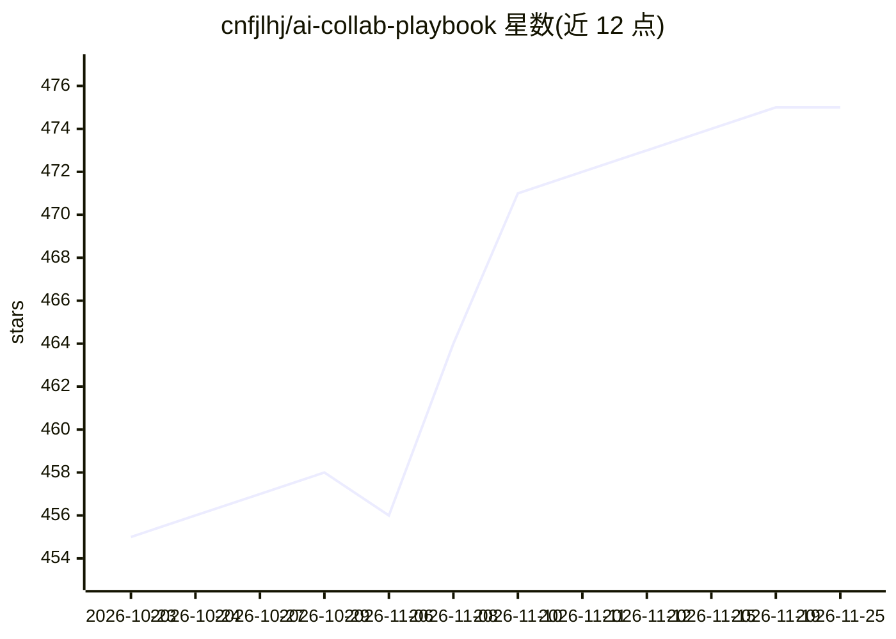

# cnfjlhj/ai-collab-playbook

⭐ 475 · Python · 推送 2026-11-23 · [GitHub](https://github.com/cnfjlhj/ai-collab-playbook) · [官网](https://github.com/cnfjlhj/ai-collab-playbook/blob/main/docs/phd-ai-collab.md) · 个人维护 · 中文 README

**面向博士生等研究者的 AI 协作方法论手册与可复用工作流**

一位 AI 方向在读博士生沉淀的 AI 协作手册：主文章讲人机协作方法论（人为主变量、上下文准备、经验沉淀、反效率幻觉），仓库内提供 AGENTS.md/CLAUDE.md 协作规则、prompts 目录（提示词优化器、概念解释、论文精读模板）以及按需取用的 Skills 工作流（论文审稿、提示词润色、去 AI 味写作等）。内容以文档形式提供，无运行代码与安装步骤。

## 筛选速览

| 维度 | 判定 | 备注 |
|---|---|---|
| AI 角色 | `ai-knowledge` | 知识聚合/清单类 |
| 许可风险 | `none` | — |
| 部署形态 | `None` |  |
| 模型依赖 | — | README 未给出锁定关系 |
| 硬件要求 | — | 无带数字的原话,不猜 |
| 安装摩擦 | `low` | 无编译、无系统依赖或容器化 |
| 成熟度 | — | 结构信号不足 |

## 能力要点

- 主文章完整方法论与三张框架配图
- 作者实际使用的 AGENTS.md / CLAUDE.md 协作规则
- 提示词模板与 10 个可按需参考的 Skills 工作流

## 适用场景

- 把 AI 引入科研、写作、编程流程时参考协作守则
- 复用论文精读、审稿、提示词润色等工作流模板
- 约束自己的 coding agent 行为时参考规则文件

## 场景标签

`提示工程` `科研工具` · 领域:Agent 开发

## 证据(README 行号)

> L5: 我是一名人工智能方向的在读博士生。从 GPT-3.5 时代开始，我就比较重度地使用 AI。几年下来，AI 已经渗透到我工作的大部分环节——科研、写作、编程、日常学习，甚至和朋友聊天时的零碎想法。这份手册就是这些经历的沉淀。
> L38: |主文章|`docs/phd-ai-collab.md`|完整方法论，2026-11-21 版|
> L41: |完整 Skills|`skills/full/README.md`|仓内所有 Skill 总目录|

## 星数曲线

2026-10-23 455 → 2026-11-25 475（+20）

---
*卡片 v1 · prompt 1.4 · 生成 2026-11-25 · 置信度 high · 依据 README sha `fda686e23afa` · [字段定义](../../DATASET.md)*
