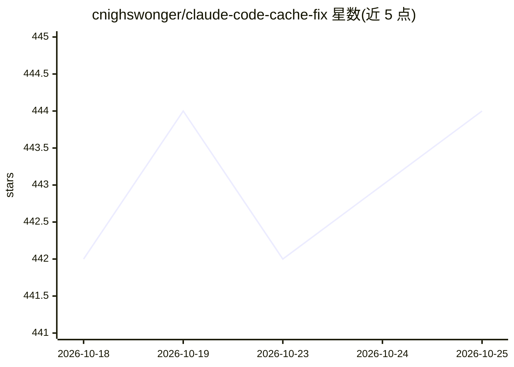

# cnighswonger/claude-code-cache-fix

⭐ 444 · JavaScript · NOASSERTION · 推送 2026-09-05 · [GitHub](https://github.com/cnighswonger/claude-code-cache-fix) · [官网](https://github.com/cnighswonger/claude-code-cache-fix) · 个人维护

**Claude Code 提示词缓存修复代理，降低配额消耗**

本地代理，部署在 Claude Code 与 Anthropic API 之间，读取并重写 POST /v1/messages 请求，规范化缓存相关结构（块顺序、fingerprint、TTL），稳定请求前缀，降低缓存未命中导致的配额消耗，并监控静默回退。支持反向代理与正向代理两种模式，正向模式需本地 CA 做 TLS 终止。通过 npm 全局安装，可用 systemd/launchd 作为服务运行。适用于恢复会话时缓存命中率低、配额消耗异常的 Claude Code 用户。

## 筛选速览

| 维度 | 判定 | 备注 |
|---|---|---|
| AI 角色 | `ai-ecosystem` | LLM/agent 周边工具 |
| 许可风险 | `permissive` | NOASSERTION |
| 部署形态 | `self-host` | docker 或自建部署 |
| 模型依赖 | locked-api |  |
| 硬件要求 | — | 无带数字的原话,不猜 |
| 安装摩擦 | `low` | 无编译、无系统依赖或容器化 |
| 成熟度 | — | 结构信号不足 |

## 能力要点

- 拦截并重写 /v1/messages 以规范化缓存结构
- 反向与正向代理双模式，正向模式保留 Remote Control 功能
- 幂等：无需修复时请求原样透传，不修改对话内容
- 默认绑定 127.0.0.1，遥测仅写本地文件

## 适用场景

- 恢复会话时缓存创建令牌反复飙升，想降低配额消耗
- 长时间会话缓存命中率不稳定，需要稳定请求前缀
- 想监控 Claude Code 是否出现缓存静默回退

## 场景标签

 · 领域:LLM 基础设施/开发者工具

## 证据(README 行号)

> L7: Cache optimization proxy for Claude Code. Fixes prompt cache bugs that cause excessive quota burn, stabilizes the re
> L25: - **Can read and rewrite `POST /v1/messages`.** That capability *is* the cache

## 星数曲线

2026-10-18 442 → 2026-10-25 444（+2）

---
*卡片 v1 · prompt 1.4 · 生成 2026-10-22 · 置信度 mid · 依据 README sha `2d03c47b7daf` · [字段定义](../../DATASET.md)*
