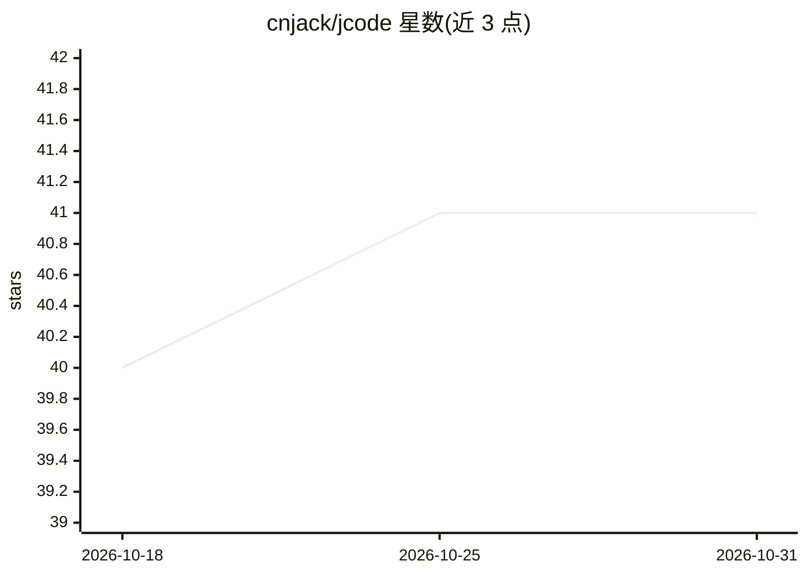

# cnjack/jcode

⭐ 41 · Go · MIT · 推送 2026-10-29 · [GitHub](https://github.com/cnjack/jcode) · [官网](https://www.j-code.net) · 个人维护

**开发者用终端 AI 编码代理，可经 SSH/Docker 远程改代码**

面向开发者的命令行 AI 编码代理，同一引擎提供终端 TUI、浏览器 UI、Tauri 桌面应用与 ACP 编辑器接入四种前端。代理读取代码库、执行字符串级编辑、运行命令并展示每一步工具调用；支持 Plan/审批/完全访问三种模式、多代理并行团队、会话目标、MCP 服务器接入、浏览器操作、cron 定时任务与技能扩展。所有工具可透明地在 SSH 远程主机或 Docker 容器内执行；模型接入为任意 OpenAI 兼容 API，可在会话中切换。提供 curl 安装脚本与 make install 源码安装两条途径。

## 筛选速览

| 维度 | 判定 | 备注 |
|---|---|---|
| AI 角色 | `ai-native` | 本体是模型或模型工具 |
| 许可风险 | `permissive` | MIT |
| 部署形态 | `desktop` | 安装包/桌面程序 |
| 模型依赖 | — | README 未给出锁定关系 |
| 硬件要求 | — | 无带数字的原话,不猜 |
| 安装摩擦 | `medium` | 含编译或系统依赖之一 |
| 成熟度 | — | 结构信号不足 |

## 能力要点

- 工具调用全程可见，编辑前可审批，Plan 模式先出结构化计划
- /ssh 连接后所有工具透明地在远程主机或 Docker 容器内执行
- 多 AI 队友并行协作、子代理（最多 3 层嵌套）与后台命令
- MCP 服务器接入（stdio/HTTP/SSE，含 OAuth）与技能包扩展

## 适用场景

- 在终端用自然语言描述任务让代理修改代码库并跑测试
- SSH 到远程服务器或绑定 Docker 容器内做代码修改与运维
- 定时跑 PR 审查/安全审查等技能任务并留完整记录

## 场景标签

`编码 Agent` · 领域:编码与开发

## 证据(README 行号)

> L7: **The AI coding agent that lives in your terminal — and now on your desktop.**
> L9: Describe a task in plain language. [J]CODE reads your codebase, writes surgical edits,
> L11: browser, or a native desktop app. Work locally or on a remote box over SSH or Docker.

## 星数曲线

2026-10-18 40 → 2026-10-31 41（+1）

---
*卡片 v1 · prompt 1.4 · 生成 2026-10-25 · 置信度 high · 依据 README sha `af12efcb7641` · [字段定义](../../DATASET.md)*
