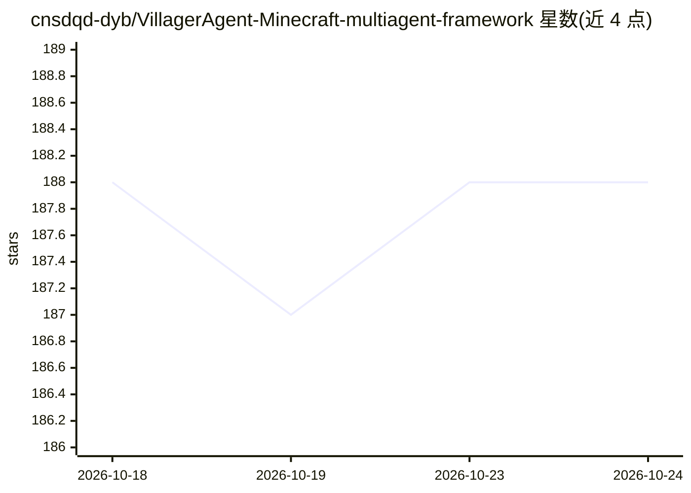

# cnsdqd-dyb/VillagerAgent-Minecraft-multiagent-framework

⭐ 187 · Python · 推送 2026-10-07 · [GitHub](https://github.com/cnsdqd-dyb/VillagerAgent-Minecraft-multiagent-framework) · [官网](https://cnsdqd-dyb.github.io/VillagerAgent.github.io/2024/04/01/VillagerAgent.html) · 组织维护 · 中文 README

**Minecraft 多智能体协作框架与基准（ACL 2024 论文）**

基于图结构的 Minecraft 多智能体框架，用于研究智能体间交互、与人协作、LLM 任务分解与合作。核心组件含 Task Decomposer、Agent Controller、State Manager 与 Base Agents；配套 VillagerBench 基准，覆盖建造、烹饪、密室逃脱等任务，另支持人-智能体与智能体-智能体实时聊天、PPO 的 LLM API 排序、自定义私人任务。运行需 Python 3.8+、Node.js/npm、本地或可达的 Minecraft 1.19.2 服务器，以及 Qwen/OpenAI/Gemini/GLM 等 API key；默认走 DashScope 的 Qwen 模型，也可用 HuggingFace Transformers 模型。以源码仓库形式提供，含 Docker 构建。

## 筛选速览

| 维度 | 判定 | 备注 |
|---|---|---|
| AI 角色 | `ai-ecosystem` | LLM/agent 周边工具 |
| 许可风险 | `none` | — |
| 部署形态 | `self-host` | docker 或自建部署 |
| 模型依赖 | — | README 未给出锁定关系 |
| 硬件要求 | — | 无带数字的原话,不猜 |
| 安装摩擦 | `low` | 无编译、无系统依赖或容器化 |
| 成熟度 | — | 结构信号不足 |

## 能力要点

- 四组件架构：Task Decomposer / Agent Controller / State Manager / Base Agents
- VillagerBench 基准：建造、烹饪、密室逃脱等协作任务，100 个目标结构
- 支持人-智能体、智能体-智能体实时聊天
- 支持 Qwen/OpenAI/Gemini/GLM API 及 HuggingFace Transformers 模型

## 适用场景

- 在 Minecraft 环境中研究多智能体协作与任务分解
- 在自有服务器上自定义多智能体任务与批量测试
- 作为多智能体基准（VillagerBench）评估协作能力

## 场景标签

`多智能体` `强化学习` `模型评测` · 领域:Agent 开发

## 证据(README 行号)

> L151: ### VillagerAgent Framework
> L152: Meet VillagerAgent, our multi-agent maestro 🎼, orchestrating a symphony of tasks with its four core components: Ta
> L27: We aim to investigate the interactions between agents within the Minecraft environment and their collaboration with

## 星数曲线

2026-10-18 188 → 2026-10-24 188（+0）

---
*卡片 v1 · prompt 1.4 · 生成 2026-10-23 · 置信度 high · 依据 README sha `652a82441482` · [字段定义](../../DATASET.md)*
