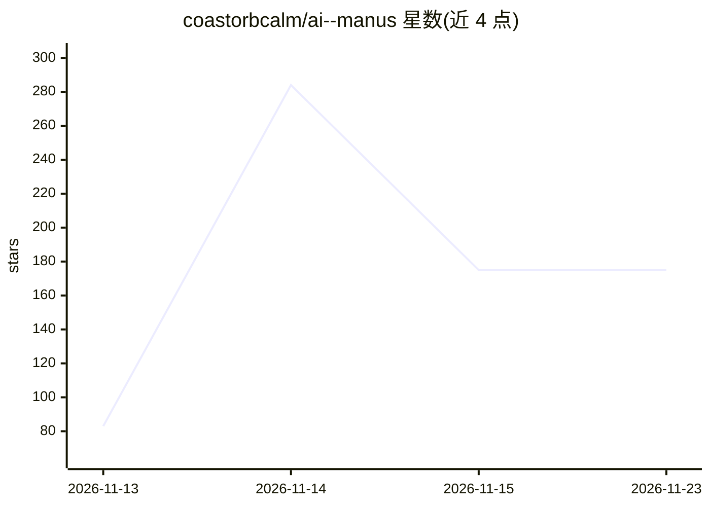

# coastorbcalm/ai--manus

⭐ 175 · Apache-2.0 · 推送 2026-11-15 · [GitHub](https://github.com/coastorbcalm/ai--manus) · 个人维护

**面向个人用户的自主 AI Agent：代跑代码与操控浏览器**

Manus 定位为自主 AI Agent，代替用户执行代码与浏览器操作：可编写并运行脚本、打开网页、填写表单、完成多步骤任务，自称面向家庭、学习与轻量办公场景，而非企业平台。README 为产品介绍性质，说明兼容性要求（最低双核 CPU、4GB 内存）、启动步骤与使用建议。仓库描述另称其支持在沙盒环境中运行多种工具与操作。README 未提供安装命令、依赖清单或模型接入方式等技术细节。

## 筛选速览

| 维度 | 判定 | 备注 |
|---|---|---|
| AI 角色 | `ai-native` | 本体是模型或模型工具 |
| 许可风险 | `permissive` | Apache-2.0 |
| 部署形态 | `None` |  |
| 模型依赖 | — | README 未给出锁定关系 |
| 硬件要求 | — | 无带数字的原话,不猜 |
| 安装摩擦 | `low` | 无编译、无系统依赖或容器化 |
| 成熟度 | — | 结构信号不足 |

## 能力要点

- 自主执行代码：编写并运行脚本完成任务
- 浏览器控制：导航网页、填写表单、收集信息
- 代码与浏览器操作可在同一工作流中衔接
- 面向小规模场景（学习/家庭/轻办公）设计

## 适用场景

- 让代理代为查网页、填表单、收集资料
- 运行小脚本与快速实验而不搭建完整环境
- 整理研究笔记与日常重复性事务

## 场景标签

`AI 助手` `浏览器自动化` · 领域:效率与自动化

## 证据(README 行号)

> L18: Manus is an autonomous AI agent designed to run code and control a browser on your behalf. Instead of acting like a
> L22: Manus is not a heavy studio suite or a complex enterprise platform. It is a focused helper built for home, study, a

## 星数曲线

2026-11-13 83 → 2026-11-23 175（+92）

---
*卡片 v1 · prompt 1.4 · 生成 2026-11-17 · 置信度 mid · 依据 README sha `0f78ee3a5dd2` · [字段定义](../../DATASET.md)*
