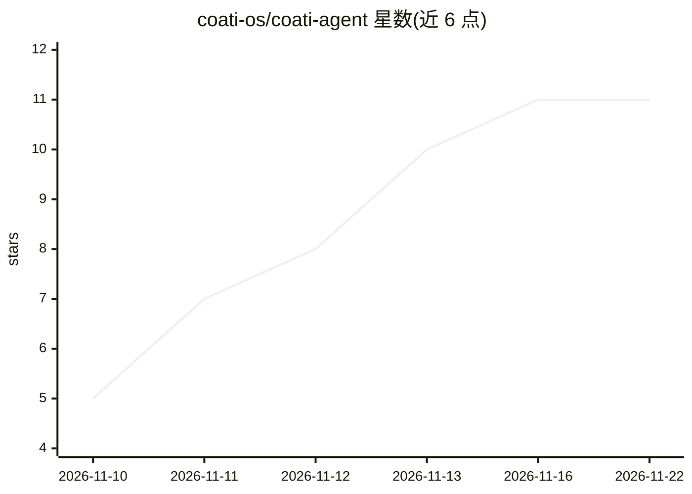

# coati-os/coati-agent

⭐ 11 · Kotlin · NOASSERTION · 推送 2026-11-11 · [GitHub](https://github.com/coati-os/coati-agent) · [官网](https://coati-os.com) · 组织维护 · 中文 README

**Android 手机上的端侧 AI agent：操作应用并验证任务完成**

以 Android 应用形式安装的移动 GUI agent，通过无障碍服务操作用户已装的原生、Flutter 和 canvas 应用，无需电脑、数据线、ADB 或 root。内置基于 PRoot 的 Alpine Linux 工作区（bash、Python、Node.js、curl 等），可写代码并生成 PDF/图表/表格文件。核心机制包括：VerifyLoop 用屏幕证据核验每步与完成状态，AppMemory 从已验证观察学习 per-app 手册，路由快速执行器让小型选择模型处理简单步骤、大模型规划循环后由 host 逐项重复。需 Android 11+ 与用户自备的模型 API key（如 Google Gemini），任务不可验证时报告为 unverified。

## 筛选速览

| 维度 | 判定 | 备注 |
|---|---|---|
| AI 角色 | `ai-native` | 本体是模型或模型工具 |
| 许可风险 | `none` | NOASSERTION |
| 部署形态 | `library` | 以包/库形式分发 |
| 模型依赖 | — | README 未给出锁定关系 |
| 硬件要求 | — | 无带数字的原话,不猜 |
| 安装摩擦 | `medium` | 含编译或系统依赖之一 |
| 成熟度 | — | 结构信号不足 |

## 能力要点

- 通过无障碍服务操作已有应用，无需插件适配、root 或 ADB
- VerifyLoop 完成审计：任务仅在有屏幕证据时标记完成，否则报 unverified
- 内置 PRoot Alpine Linux 工作区，可运行代码并产出 PDF/图表/表格
- AppMemory 从已验证观察学习 per-app 手册，后续访问步骤数减少

## 适用场景

- 用日常语言让手机代设闹钟、查酒店比价并保存笔记
- 跨应用完成任务：在一个应用读取信息、在另一个应用执行操作
- 在手机上直接生成 PDF 报告、图表或表格文件

## 场景标签

`GUI 自动化` · 领域:效率与自动化

## 证据(README 行号)

> L5: **An AI agent that lives on your Android phone**
> L12: Describe the result you want. Coati Agent operates your apps to get there, uses its built-in Linux workspace
> L149: of ordinary users. **Coati Agent ships as an Android app** and operates other apps through Android's

## 星数曲线

2026-11-10 5 → 2026-11-22 11（+6）

---
*卡片 v1 · prompt 1.4 · 生成 2026-11-18 · 置信度 mid · 依据 README sha `a0e36b9a7a8c` · [字段定义](../../DATASET.md)*
