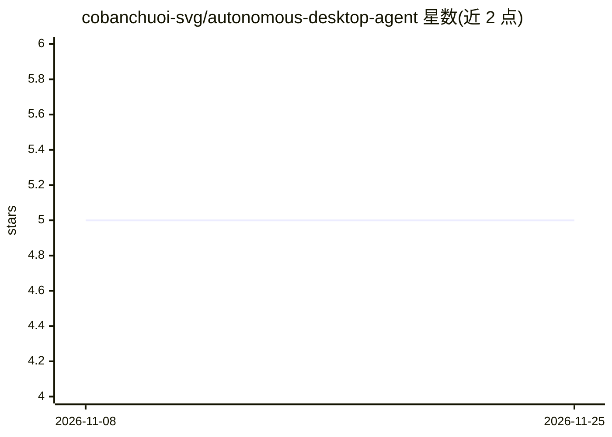

# cobanchuoi-svg/autonomous-desktop-agent

⭐ 5 · Python · MIT · 推送 2026-11-06 · [GitHub](https://github.com/cobanchuoi-svg/autonomous-desktop-agent) · 个人维护

**面向 Windows 桌面的自主自动化 Agent，本地 OCR 加可选 LLM 路由**

以英文/越南语请求路由到已注册工作流为核心：默认用 Windows Media OCR 本地读取屏幕文本并映射为带坐标的元素，结合 UI Automation 与坐标注册表定位前台窗口、弹窗或桌面上的目标；仅在本地 OCR 无法定位元素时才回退到 Gemini Vision。支持文本输入、打开应用、联网搜索，未知任务以草稿脚本形式生成并需用户显式批准后执行。定位为学习/研究用的实验性原型，作者声明不替代商业 computer-use 系统。

## 筛选速览

| 维度 | 判定 | 备注 |
|---|---|---|
| AI 角色 | `ai-native` | 本体是模型或模型工具 |
| 许可风险 | `permissive` | MIT |
| 部署形态 | `library` | 以包/库形式分发 |
| 模型依赖 | local-ok | 支持本地模型 |
| 硬件要求 | — | 无带数字的原话,不猜 |
| 安装摩擦 | `low` | 无编译、无系统依赖或容器化 |
| 成熟度 | `idea` | |

## 能力要点

- Windows Media OCR 本地识别屏幕文本，无需 GPU 或大模型下载
- LLM 路由可选：本地 Ollama 或云端 Gemini API
- 安全模型：allow-list 校验、坐标失效拒绝、破坏性命令拦截、脚本草稿需批准
- 受控学习：记录动作历史与失败模式，人在回路审批变更

## 适用场景

- 用自然语言让 Agent 打开应用、搜索网页、读取屏幕文本
- 在越南语/英文混合环境下路由桌面任务
- 为复杂多步桌面任务生成草稿脚本并人工审批后运行

## 场景标签

`GUI 自动化` `OCR` · 领域:效率与自动化

## 证据(README 行号)

> L8: An experimental Windows desktop agent built around a simple principle:
> L16: - Route English and Vietnamese requests to registered workflows.
> L76: The project supports an optional cloud Gemini provider and local Ollama.

## 星数曲线

2026-11-08 5 → 2026-11-25 5（+0）

---
*卡片 v1 · prompt 1.4 · 生成 2026-11-21 · 置信度 high · 依据 README sha `dc7dbc649b8d` · [字段定义](../../DATASET.md)*
