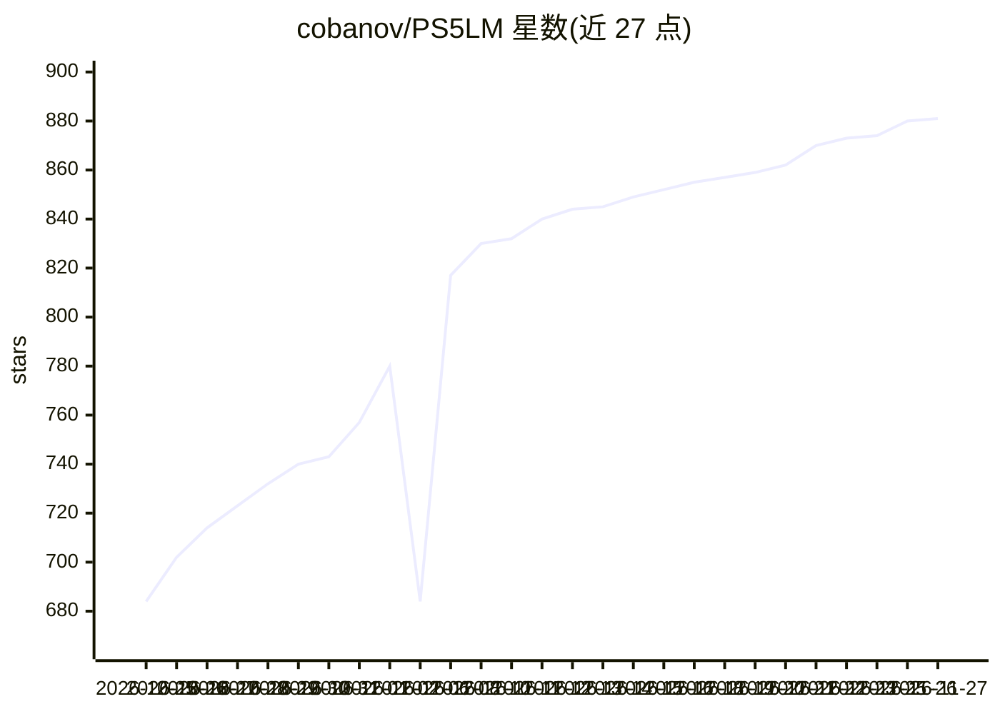

# cobanov/PS5LM

⭐ 881 · Python · GPL-3.0 · 推送 2026-11-25 · [GitHub](https://github.com/cobanov/PS5LM) · [官网](https://ps5lm.cobanov.dev) · 个人维护

**让破解版 PS5 作为本地 GGUF 模型服务器供局域网使用**

PS5 自制程序应用，将 llama.cpp 的 Vulkan 后端运行在主机的 RDNA 2 GPU 上，加载 GGUF 模型并向局域网设备提供 OpenAI、Anthropic 与 TypeSafe 决策模型的 API 端点，附带面向电视的界面，可在屏幕上展示请求流与主机温度/功耗监控。应用内置规划器按空闲内存计算最长上下文，自动从 Hugging Face 下载模型到内置存储/M.2/USB。前提是主机已越狱且运行指定固件并加载 kstuff-lite、etaHEN 等 payload。

## 筛选速览

| 维度 | 判定 | 备注 |
|---|---|---|
| AI 角色 | `ai-ecosystem` | LLM/agent 周边工具 |
| 许可风险 | `viral` | GPL-3.0 |
| 部署形态 | `desktop` | 安装包/桌面程序 |
| 模型依赖 | local-ok | 支持本地模型 |
| 硬件要求 | — | 无带数字的原话,不猜 |
| 安装摩擦 | `medium` | 含编译或系统依赖之一 |
| 成熟度 | — | 结构信号不足 |

## 能力要点

- llama.cpp Vulkan 后端运行在 PS5 GPU，支持其全部架构与量化格式
- 提供 OpenAI/Anthropic 兼容端点及 /v1/systemone 决策模型 API
- 内置内存规划器与 Suggested 模型列表，自动从 Hugging Face 下载
- 实验性 fleet：通过 RPC 将一个 GGUF 拆分到多台主机与 PC GPU

## 适用场景

- 把越狱 PS5 当作家庭局域网的私有模型服务器
- 让笔记本/手机/编程工具指向主机 8081 端口调用模型
- 在电视上直观观看请求流与主机运行状态

## 场景标签

`推理引擎` · 领域:训练与推理

## 证据(README 行号)

> L6:  llama.cpp on the console's GPU, with OpenAI and Anthropic APIs and a screen made for the TV.
> L17: PS5LM is for anyone with a jailbroken PS5 who wants a private model server at home. It loads a GGUF
> L34: - **It runs on the GPU.** llama.cpp's Vulkan backend on the console's RDNA 2 GPU, with 11.4 GB of the

## 星数曲线

2026-10-25 684 → 2026-11-27 881（+197）

---
*卡片 v1 · prompt 1.4 · 生成 2026-11-25 · 置信度 high · 依据 README sha `c54eaba1ede3` · [字段定义](../../DATASET.md)*
