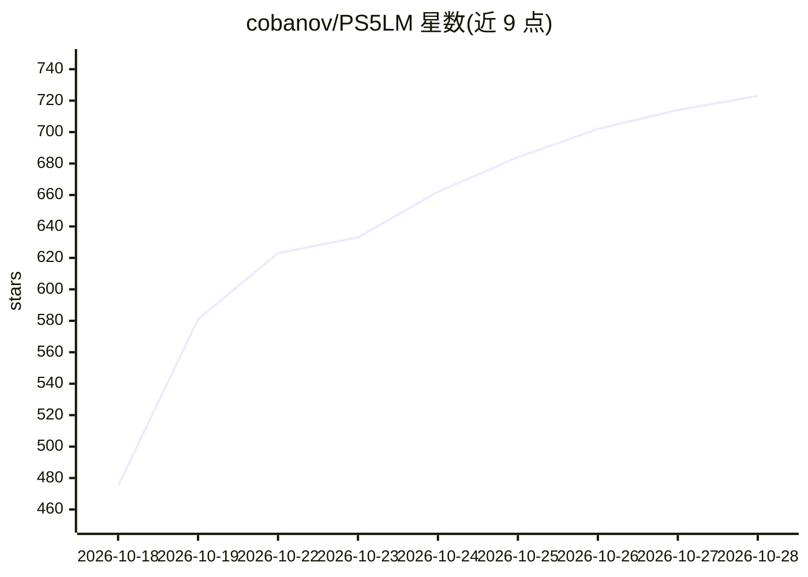

# cobanov/PS5LM

⭐ 732 · C++ · GPL-3.0 · 推送 2026-10-26 · [GitHub](https://github.com/cobanov/PS5LM) · [官网](https://ps5lm.cobanov.dev) · 个人维护

**在越狱 PS5 上运行 GGUF 模型的家用模型服务器**

面向拥有越狱 PS5 的用户：将 llama.cpp 的 Vulkan 后端跑在 PS5 的 RDNA 2 GPU 上，加载 GGUF 模型并用 11.4 GB 共享内存承载模型与上下文，通过 OpenAI /v1/chat/completions、Anthropic /v1/messages 及决策模型 /v1/systemone 接口向局域网内笔记本、手机和编码工具提供服务，同时提供电视端界面展示请求流、性能监控与模型管理，可从 Hugging Face 下载模型。要求固件 7.00–13.60 并预装 kstuff-lite、etaHEN、ShadowMountPlus 等 payload。

## 筛选速览

| 维度 | 判定 | 备注 |
|---|---|---|
| AI 角色 | `ai-ecosystem` | LLM/agent 周边工具 |
| 许可风险 | `viral` | GPL-3.0 |
| 部署形态 | `desktop` | 安装包/桌面程序 |
| 模型依赖 | local-ok | 支持本地模型 |
| 硬件要求 | — | 无带数字的原话,不猜 |
| 安装摩擦 | `low` | 无编译、无系统依赖或容器化 |
| 成熟度 | — | 结构信号不足 |

## 能力要点

- llama.cpp Vulkan 后端运行于 PS5 RDNA 2 GPU，支持 llama.cpp 已知的全部架构与量化
- 提供 OpenAI、Anthropic 兼容 API 与 /v1/systemone 决策模型接口
- 电视端界面：请求流展示、温/功耗/负载监控、模型下载与规划
- 支持带图像投影器的多模态模型读图

## 适用场景

- 把越狱 PS5 当作无 PC、无云的家用私有模型服务器
- 让笔记本、手机和编码工具（Claude Code 等）调用局域网内模型
- 在电视上实时查看模型请求与主机状态

## 场景标签

`推理引擎` · 领域:训练与推理

## 证据(README 行号)

> L17: PS5LM is for anyone with a jailbroken PS5 who wants a private model server at home. It loads a GGUF
> L37: - **It answers your network.** OpenAI's `/v1/chat/completions`, Anthropic's `/v1/messages` (Claude Code
> L78: You need a PS5 on firmware 7.00 to 13.60, jailbroken, with these payloads loaded:

## 星数曲线

2026-10-18 475 → 2026-10-28 723（+248）

---
*卡片 v1 · prompt 1.4 · 生成 2026-10-21 · 置信度 high · 依据 README sha `ea1cecb23bb1` · [字段定义](../../DATASET.md)*
