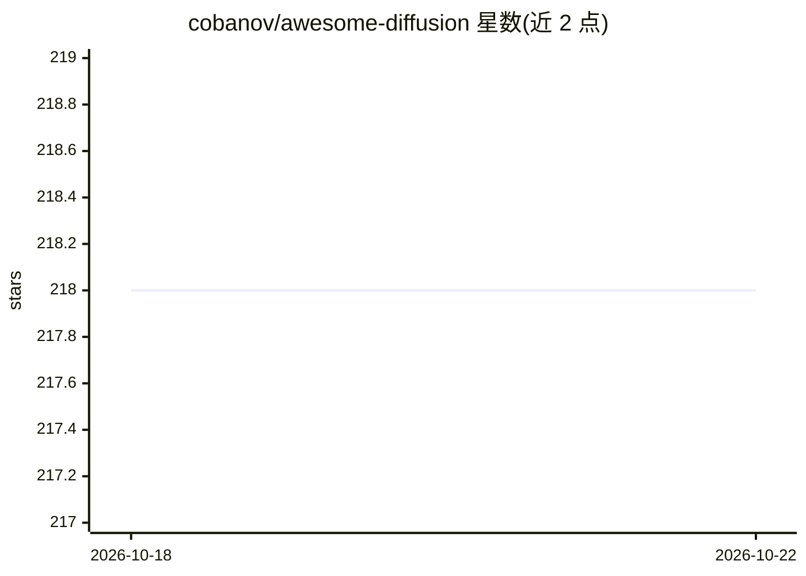

# cobanov/awesome-diffusion

⭐ 218 · MIT · 推送 2026-10-20 · [GitHub](https://github.com/cobanov/awesome-diffusion) · 个人维护

**扩散模型资源策展清单：notebook、工具、教程与论文链接**

awesome-list 形式的扩散模型资源聚合：按 Colab Notebooks、Diffusion Models、Prompt Engineering、Tools、Benchmarks、Tutorials、Papers、Discord 频道等分类收录条目，覆盖 Disco Diffusion、Stable Diffusion、latent-diffusion 等模型仓库，以及 GFPGAN、diffusers、chaiNNer 等工具。多数条目仅给链接和一句话描述，部分标注 description will be defined 未补充说明。仓库本身不含代码，不提供安装运行方式。

## 筛选速览

| 维度 | 判定 | 备注 |
|---|---|---|
| AI 角色 | `ai-knowledge` | 知识聚合/清单类 |
| 许可风险 | `permissive` | MIT |
| 部署形态 | `None` |  |
| 模型依赖 | — | README 未给出锁定关系 |
| 硬件要求 | — | 无带数字的原话,不猜 |
| 安装摩擦 | `medium` | 含编译或系统依赖之一 |
| 成熟度 | — | 结构信号不足 |

## 能力要点

- 按 8 个分类组织的扩散模型资源链接
- 收录 Colab notebook、模型仓库、工具与提示词工程资源
- 含 ImageBench 等文生图基准条目

## 适用场景

- 查找扩散模型的入门 notebook 与教程
- 了解图像生成相关的工具与提示词资源
- 寻找扩散模型社区（Discord）入口

## 场景标签

`精选清单` · 领域:学习与行业

## 证据(README 行号)

> L1: # Awesome Diffusion Awesome
> L3: A curated list of awesome Diffusion notebooks, tools, software, tutorials and resources.

## 星数曲线

2026-10-18 218 → 2026-10-22 218（+0）

---
*卡片 v1 · prompt 1.4 · 生成 2026-10-22 · 置信度 high · 依据 README sha `a6b8add42b33` · [字段定义](../../DATASET.md)*
