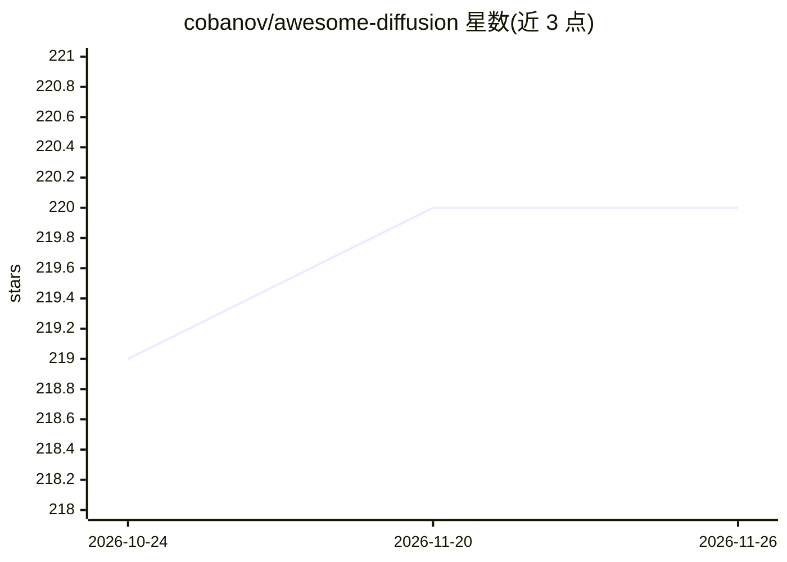

# cobanov/awesome-diffusion

⭐ 220 · MIT · 推送 2026-11-14 · [GitHub](https://github.com/cobanov/awesome-diffusion) · 个人维护

**扩散模型学习资源清单：为图像生成者汇编教程与工具**

一份扩散模型方向的 awesome 清单，按 Colab Notebook、扩散模型、Prompt 工程、工具、基准、教程、论文、Discord 频道等分类汇编外部资源链接，覆盖 Disco Diffusion、Stable Diffusion 等模型与图像修复、插帧、放大类工具。条目多为待补充描述的聚合列表，面向希望上手或查找扩散模型资源的读者，仓库本身不包含代码或安装方式。

## 筛选速览

| 维度 | 判定 | 备注 |
|---|---|---|
| AI 角色 | `ai-knowledge` | 知识聚合/清单类 |
| 许可风险 | `permissive` | MIT |
| 部署形态 | `None` |  |
| 模型依赖 | — | README 未给出锁定关系 |
| 硬件要求 | — | 无带数字的原话,不猜 |
| 安装摩擦 | `medium` | 含编译或系统依赖之一 |
| 成熟度 | — | 结构信号不足 |

## 能力要点

- 按 Notebook/模型/工具/教程/论文等分类组织的扩散模型资源汇编
- 收录 GFPGAN、Real-ESRGAN、diffusers 等图像生成与修复工具条目
- 含 VRAM 需求指南与 text-to-image 模型排行榜等教程与基准链接

## 适用场景

- 查找扩散模型的 Colab Notebook 快速上手
- 检索图像生成、修复、放大相关工具
- 了解 text-to-image 模型的基准与社区资源

## 场景标签

`精选清单` · 领域:学习与行业

## 证据(README 行号)

> L3: A curated list of awesome Diffusion notebooks, tools, software, tutorials and resources.
> L7: ## Colab Notebooks

## 星数曲线

2026-10-24 219 → 2026-11-26 220（+1）

---
*卡片 v1 · prompt 1.4 · 生成 2026-11-25 · 置信度 high · 依据 README sha `08e50117976c` · [字段定义](../../DATASET.md)*
