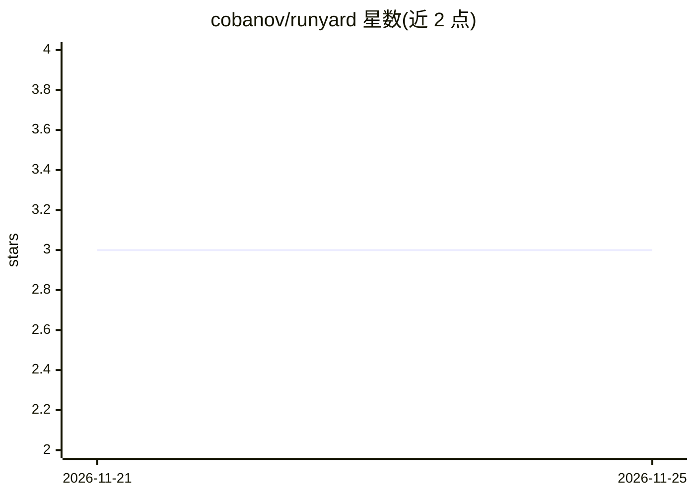

# cobanov/runyard

⭐ 3 · Go · Apache-2.0 · 推送 2026-11-19 · [GitHub](https://github.com/cobanov/runyard) · [官网](https://runyard.cobanov.dev) · 个人维护

**自托管 ML 训练运行追踪器：GPU 状态、手机告警与 agent MCP 接入**

单 Go 二进制加 PostgreSQL 组成的自托管训练运行追踪服务：Python 库三行代码将指标、样本、日志与检查点发送到自建服务器，Web UI 与 iPhone/Android 应用实时展示并提供运行结束/失败/失联推送（ntfy、Slack、Discord、Telegram、webhook）。beacon 采集各机器 GPU、进程与资源状态。内置 MCP 服务器与 --json CLI，供编码 agent 查询运行并自动生成报告。README 自述功能少于 W&B 或 MLflow 属有意为之。

## 筛选速览

| 维度 | 判定 | 备注 |
|---|---|---|
| AI 角色 | `ai-ecosystem` | LLM/agent 周边工具 |
| 许可风险 | `permissive` | Apache-2.0 |
| 部署形态 | `self-host` | docker 或自建部署 |
| 模型依赖 | — | README 未给出锁定关系 |
| 硬件要求 | — | 无带数字的原话,不猜 |
| 安装摩擦 | `low` | 无编译、无系统依赖或容器化 |
| 成熟度 | — | 结构信号不足 |

## 能力要点

- 三行 Python 记录指标、样本、日志与检查点，后台线程发送不阻塞训练
- 兼容 Hugging Face Trainer/TRL、Accelerate、Lightning、Keras 等框架一行接入，并可桥接已有 W&B 日志
- 运行状态五分类（finished/failed/stopped/crashed/无进度）与 NaN 损失等数据检查告警
- MCP 服务器与 SKILL.md 供编码 agent 读取运行、对比曲线并留下结论

## 适用场景

- 在自己的 GPU 上训练模型并实时查看损失与进度
- 训练挂掉或失联时收到手机推送
- 让编码 agent 通过 MCP 查询和汇报训练状态
- 无 W&B 账号的离线环境记录实验

## 场景标签

`MLOps` · 领域:训练与推理

## 证据(README 行号)

> L6:  A self-hosted tracker for ML runs: one Go binary and PostgreSQL, a web UI, iPhone and Android apps, and an MCP serv
> L42: - **Your agents read it.** An MCP server at `/mcp` and a `--json` CLI: list runs, read curves, look at the samples,

## 星数曲线

2026-11-21 3 → 2026-11-25 3（+0）

---
*卡片 v1 · prompt 1.4 · 生成 2026-11-22 · 置信度 high · 依据 README sha `a33d51fa0b89` · [字段定义](../../DATASET.md)*
