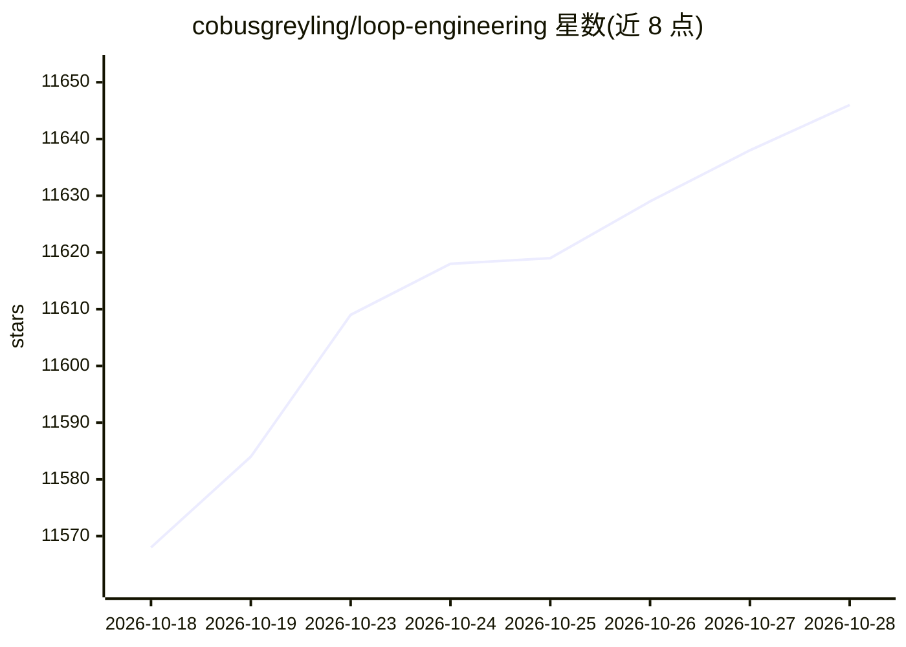

# cobusgreyling/loop-engineering

⭐ 11,652 · TypeScript · MIT · 推送 2026-10-28 · [GitHub](https://github.com/cobusgreyling/loop-engineering) · [官网](https://cobusgreyling.github.io/loop-engineering/) · 个人维护 · 中文 README

**AI 编程代理的循环工程模式库与 CLI 工具集**

面向围绕代码库运行 AI 编程代理的开发者，提供模式库、起步模板与统一 CLI（npx @cobusgreyling/loop：init/doctor/status/audit/cost）。核心机制是设计让系统发现工作、分派给代理、验证结果并持久化状态的循环，替代手工连续提示；包含 Daily Triage、PR Babysitter、CI Sweeper 等 8 种按节奏与风险等级（L1 报告→L2 辅助→L3 无人值守）组织的模式。支持 Claude/Grok/Codex/OpenClaw/Opencode/GitHub Actions 等工具，首周为 report-only，明确提示 token 成本与无人值守风险。

## 筛选速览

| 维度 | 判定 | 备注 |
|---|---|---|
| AI 角色 | `ai-ecosystem` | LLM/agent 周边工具 |
| 许可风险 | `permissive` | MIT |
| 部署形态 | `library` | 以包/库形式分发 |
| 模型依赖 | — | README 未给出锁定关系 |
| 硬件要求 | — | 无带数字的原话,不猜 |
| 安装摩擦 | `low` | 无编译、无系统依赖或容器化 |
| 成熟度 | — | 结构信号不足 |

## 能力要点

- 统一 CLI 入口 init/doctor/status/audit/cost，npx 五分钟起步
- 8 种循环模式按节奏、成本与自动化等级组织
- L1 报告→L2 辅助→L3 无人值守的分级推进策略与 Loop Ready 评分
- 多代理工具适配：Claude Code/Grok/Codex/OpenClaw/Opencode/GitHub Actions

## 适用场景

- 让 AI 代理自动维护仓库健康（issue 分诊、CI、依赖）
- 自动看护 PR 的合并与验证过程
- 在 GitHub Actions 中以极少文件运行代理循环

## 场景标签

`编码 Agent` · 领域:编码与开发

## 证据(README 行号)

> L35: You design a system that discovers work, hands it to agents, verifies results, and persists state — instead of typi
> L41: This is a **pattern library for operating agents around a codebase**. It is not a “rewrite the module” button.
> L83: Claude Code (including the plugin) · Grok · Codex · OpenClaw · Opencode · GitHub Actions

## 星数曲线

2026-10-18 11,568 → 2026-10-28 11,646（+78）

---
*卡片 v1 · prompt 1.4 · 生成 2026-10-20 · 置信度 high · 依据 README sha `d7ce9d5a6b0d` · [字段定义](../../DATASET.md)*
