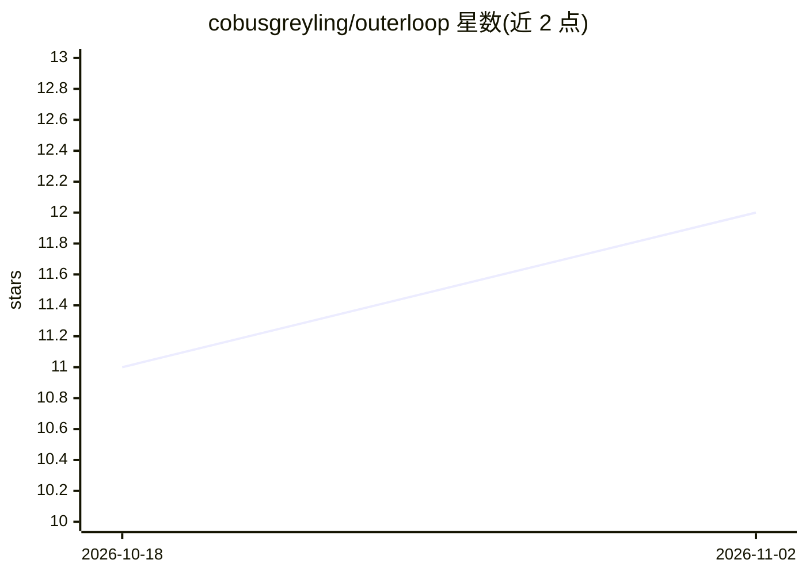

# cobusgreyling/outerloop

⭐ 12 · TypeScript · MIT · 推送 2026-11-01 · [GitHub](https://github.com/cobusgreyling/outerloop) · [官网](https://www.npmjs.com/package/@cobusgreyling/outerloop) · 个人维护

**面向 agentic 工程的治理层：证据→裁决→可问责**

为使用编码 agent 的团队提供治理原语的 CLI 工具：将 agent 运行打包为证据包，由人发出带理由的 ship/block 裁决，写入账本以重建决策链，并可对治理健康度评分。以 npm 包与 npx 命令提供，支持 Cursor、Claude Code、loop-engineering 或自定义 harness 接入，提供 GitHub Actions 证据门与三级渐进采用路径（个人→团队→工厂）。声明为 loop-engineering 的伴随项目，可独立运行。

## 筛选速览

| 维度 | 判定 | 备注 |
|---|---|---|
| AI 角色 | `ai-ecosystem` | LLM/agent 周边工具 |
| 许可风险 | `permissive` | MIT |
| 部署形态 | `library` | 以包/库形式分发 |
| 模型依赖 | — | README 未给出锁定关系 |
| 硬件要求 | — | 无带数字的原话,不猜 |
| 安装摩擦 | `low` | 无编译、无系统依赖或容器化 |
| 成熟度 | — | 结构信号不足 |

## 能力要点

- evidence/verdict/ledger/audit 四类治理命令
- 面向 Cursor、Claude Code 及自定义 harness 的初始化脚手架
- GitHub Actions CI 证据门集成
- 三级渐进采用：核心环→团队→工厂（dashboard、审计）

## 适用场景

- 在合并前对 agent 运行结果做带理由的人审裁决
- 为团队建立 agent 产出的证据与可追溯账本
- 在 CI 中加入证据门禁

## 场景标签

`LLM 可观测性` · 领域:评测与运维

## 证据(README 行号)

> L12: Governance primitives for agentic engineering — any harness, any team size.
> L19: Agent run  →  Evidence package  →  Human verdict  →  Ledger  →  Answerability

## 星数曲线

2026-10-18 11 → 2026-11-02 12（+1）

---
*卡片 v1 · prompt 1.4 · 生成 2026-11-02 · 置信度 high · 依据 README sha `ad2f85e1a4e1` · [字段定义](../../DATASET.md)*
