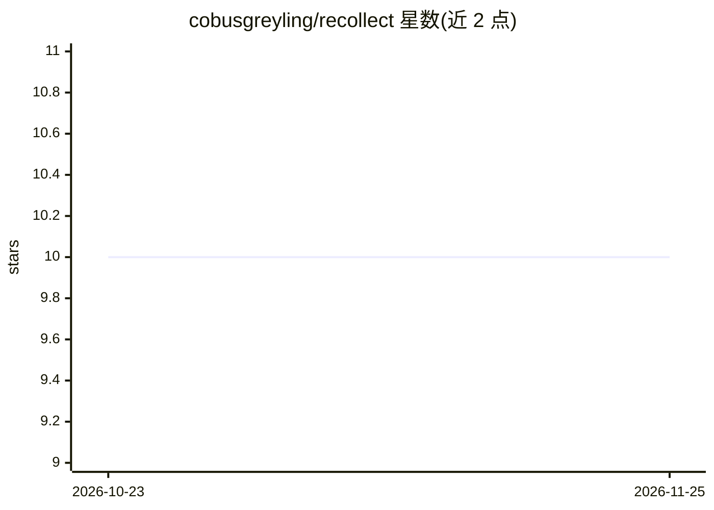

# cobusgreyling/recollect

⭐ 10 · Python · Apache-2.0 · 推送 2026-06-13 · [GitHub](https://github.com/cobusgreyling/recollect) · [官网](https://cobusgreyling.github.io/recollect/) · 个人维护

**为 AI agent 提供自托管长期记忆层的 Python 库**

面向 agent/助手应用的长期记忆库，以库形式嵌入应用：从对话中添加事实（可选 LLM 抽取），按 user_id/agent_id/run_id 分区，支持语义+关键词+实体加权的混合检索；存储后端可插拔（SQLite 默认，Qdrant/Chroma/pgvector 可选）。提供 LangChain（tools + Runnable）与 LlamaIndex（BaseMemory）集成及适配包，Apache 2.0 许可，本地开发模式无需 API key。

## 筛选速览

| 维度 | 判定 | 备注 |
|---|---|---|
| AI 角色 | `ai-ecosystem` | LLM/agent 周边工具 |
| 许可风险 | `permissive` | Apache-2.0 |
| 部署形态 | `library` | 以包/库形式分发 |
| 模型依赖 | — | README 未给出锁定关系 |
| 硬件要求 | — | 无带数字的原话,不猜 |
| 安装摩擦 | `medium` | 含编译或系统依赖之一 |
| 成熟度 | — | 结构信号不足 |

## 能力要点

- ADD-only 事实存储与 user_id/agent_id/run_id 多租户分区
- 混合检索返回 semantic/keyword/entity_overlap 各项得分，可解释排序
- 可插拔存储：SQLite（默认）、Qdrant、Chroma、pgvector
- LangChain 与 LlamaIndex 官方集成及独立适配包

## 适用场景

- 为多 agent 系统提供按会话隔离的长期记忆
- 在现有 LangChain/LangGraph 应用中接入记忆节点
- 测试/CI 中以零 API key 的本地模式运行记忆层
- 自托管场景下存储和检索用户偏好等长期事实

## 场景标签

`Agent 记忆` · 领域:Agent 开发

## 证据(README 行号)

> L10: Long-term **memory layer** for AI agents and assistants—self-hosted, **library-first**, and integration-ready for *
> L27: - **Framework-native, not framework-heavy**: Real (not toy) integrations for LangChain (tools + Runnable) and Llama

## 星数曲线

2026-10-23 10 → 2026-11-25 10（+0）

---
*卡片 v1 · prompt 1.4 · 生成 2026-11-19 · 置信度 high · 依据 README sha `8dd4240ad132` · [字段定义](../../DATASET.md)*
